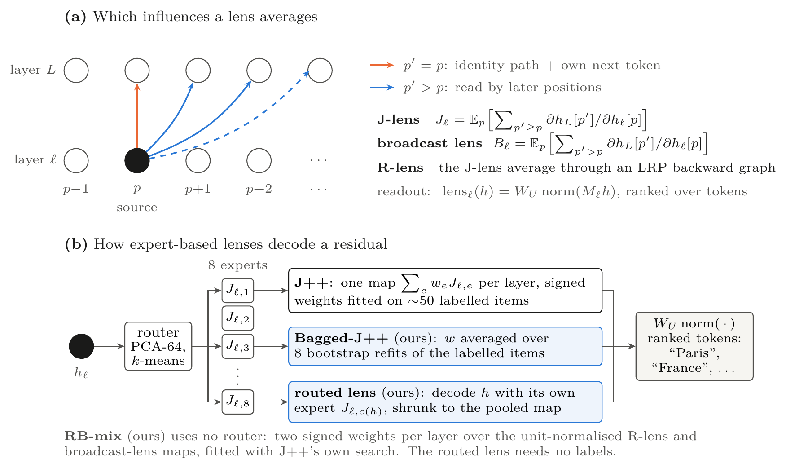

<!-- Draft fragment; merged into paper.md. Numbers are filled from results/ only. -->

## 1 Introduction

Gurnee et al. (2026) introduced the *Jacobian lens* (J-lens): to read what an intermediate
residual-stream vector h_l is disposed to make a language model say, transport it to the final
layer with the corpus-averaged Jacobian J_l = E[∂h_final/∂h_l], then decode it with the model's own
unembedding. The tokens the J-lens surfaces in a contiguous mid-depth band, the *J-space*, behave
like the contents of a global workspace. They are causally used (swapping one concept's lens
coordinate for another's redirects multi-hop answers), selectively and flexibly routed, and show
ignition-like dynamics. These claims were established on Claude models and reproduced on Qwen
3.6 27B. The J++ Lens (Ayonrinde & Lindsey, 2026) then made the readouts markedly more faithful,
raising recall@10 of latent intermediates on Qwen3.6-27B from 35.7% to 55.2%.

Two practical questions remain open. (1) **Does any of this hold in a small model?** If the J-space
is a product of scale, its properties should weaken or vanish at sub-billion scale. If it is a
generic consequence of residual-stream computation, they should persist. (2) **Can the lens be
fitted and read more efficiently?** The reference estimator needs d_model backward passes per
fitting prompt, and J++ additionally needs labelled evaluation items to weight its expert
Jacobians. Both costs are barriers to using workspace lenses as routine tools.

We study both questions on Qwen3-0.6B (28 layers, d_model = 1024) under a deliberately austere
budget: one 4-core CPU, no GPU. Our contributions:

1. **A small-model reproduction with controls.** We reproduce the J-lens, the R-Lens and the J++
   Lens on Qwen3-0.6B with the authors' released prompt sets and scoring conventions. We add a
   ridge-tuned regression-lens baseline, matched-norm random and logit-lens controls for every
   causal swap, and item-level bootstrap intervals throughout. The J-lens's advantage over the
   logit lens is real but concentrated in mid-depth layers and on one evaluation (typos).
2. **J++ at small scale, and two pitfalls.** J++'s gain over the J-lens shrinks from about 20
   points at 27B to 6.7 (mean over 25 splits). About two-thirds of that comes from the LRP backward
   pass and a third from the learned expert weights. We document two implementation
   pitfalls that silently distort J++-style evaluations. With a small fitting corpus, empty expert
   clusters give all-zero maps, which score a spurious perfect recall under the strict rank
   rule. Masking tokens before combining experts penalises negative weight sums.
3. **Label-free alternatives that come close to J++.** Routing each residual through its own LRP
   expert, with count-adaptive shrinkage toward the pooled map, needs no labelled data. It comes within
   1.6 points of J++'s held-out recall over 25 fresh splits.
4. **The broadcast lens.** We define a lens that keeps only influence on strictly *later*
   positions, the attention-carried traffic that a global-workspace reading identifies with
   availability. It is weak on its own but ranks some intermediates no other lens finds. Mixed with the R-lens
   (two weights per layer), it gains mainly on multihop bridge entities.
5. **Two pre-registered, multi-split tests of improvements over J++, with a negative result.**
   Because the released evaluations are small, we pre-register candidate improvements and test them
   on fresh fitting/held-out splits with a stated win criterion.
   - Round 2 (five splits): two candidates meet the criterion by small margins, bagging J++'s
     weights and an R-lens/broadcast mix.
   - Round 3 (twenty new splits): both tie J++, as does an LRP-broadcast mix.

   J++ is not beaten. Bagging halves its overfitting to the 47 labelled items, but does not raise
   held-out recall.
6. **Sketch estimators** of the average Jacobian, whose headline result is negative. They use
   Haar-random probes, the exactly known identity path, control variates and *readout-aware* probe
   shaping. We prove they are unbiased and derive their variance.
   - With independent prompts, no such sketch beats the exact estimator at equal cost.
   - The planned online control variate diverges, as a variance recursion we derive predicts. A
     shrunk version fixes it.
   - A closed-form, weights-only predictor ρ(A) matches the measured gain from shaping, but shaping
     does not improve recall.

We report every comparison, including those our methods lose. Table 0 summarises which claims carry over to 0.6B parameters, and Figure 1 shows the lenses we
compare.

**Table 0.** Claims scorecard: what carries over to Qwen3-0.6B.

| Claim (large models) | Qwen3-0.6B (this work) | Verdict |
|---|---|---|
| The J-lens reads latent intermediates better than the logit lens | 36.7% vs 31.9% recall@10; the advantage lies in layers 4–19 and on typo correction | holds |
| Readable content occupies a contiguous band of layers | readouts peak in layers 20–24 (71–86% of depth), chosen by a pre-declared rule | holds |
| J-lens directions are used causally downstream | argument swaps succeed on 28–48% of trials vs 7–8% for logit-lens directions and ≤2% for an unrelated target; carried by one category | holds, narrowly |
| Causal content is confined to that band | swaps succeed on 43–48% in every 5-layer window from layer 3 to 19, against 28% in the readout band (exploratory) | not at 0.6B |
| Ignition-like, abrupt switching between concepts | the network sharpens competing concepts beyond a linear mix, but progressively with depth and as much through the logit lens | partly |
| Implicit concepts (associations, rhyme plans) are readable | ≤1% recall for every lens; the right concept's median rank is 1,000–2,000 | not at 0.6B |
| J++ makes readouts markedly more faithful (35.7% → 55.2% at 27B) | +6.7 points over the J-lens over 25 splits, about two-thirds from the LRP backward pass | much smaller |
| J++'s learned expert weights add substantially | +2.2 points over the plain LRP lens (25 splits); they overfit 47 labelled items, and no pre-registered change improves on them | modestly |

**Figure 1.** The lenses compared.

- (a) What each lens averages:
  - the J-lens: a residual's influence on the final layer at the same and all later positions;
  - the broadcast lens: later positions only, which removes the identity path and the position's
    own next-token computation;
  - the R-lens: the J-lens average computed through an LRP backward graph.
- (b) Expert-based lenses route a residual to one of eight cluster-specific Jacobians:
  - J++ combines them with signed weights fitted on labelled items;
  - Bagged-J++ averages those weights over bootstrap refits;
  - the routed lens decodes each residual with its own expert and needs no labels.
