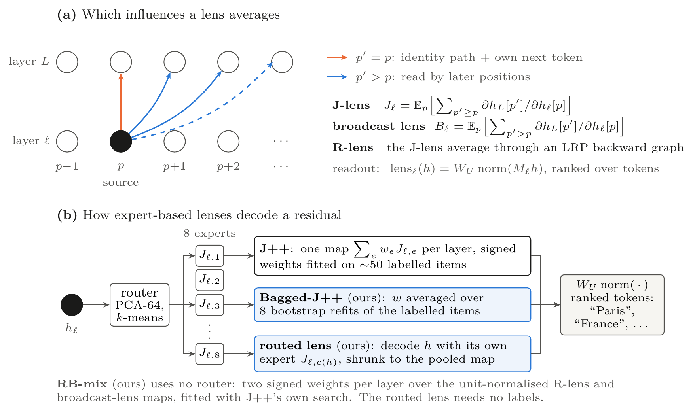
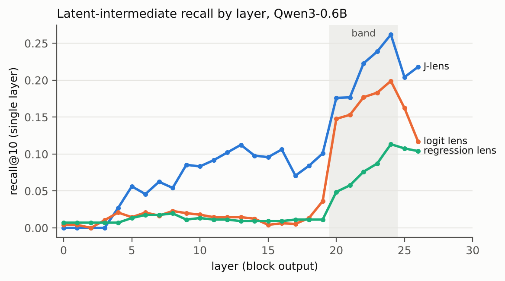
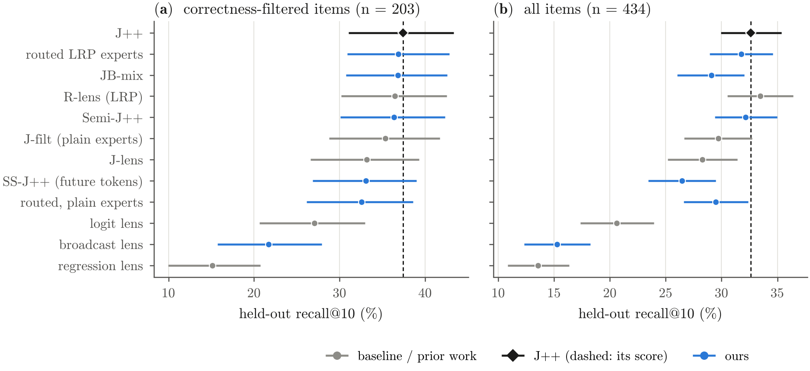
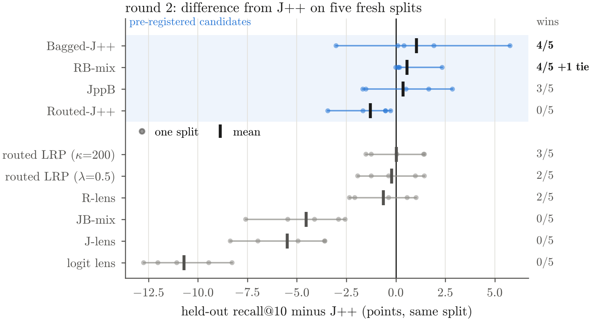
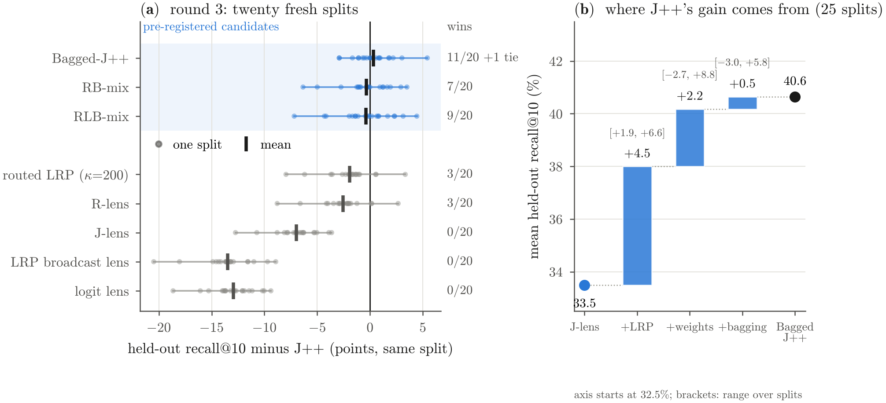
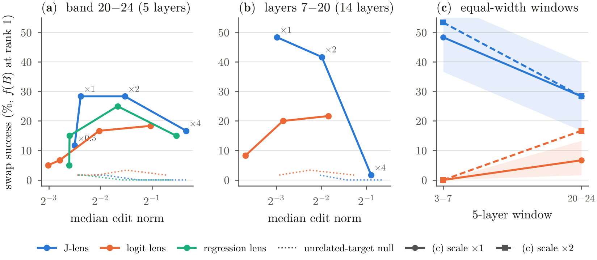
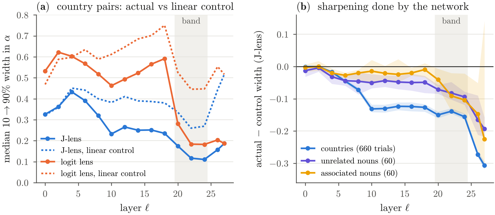
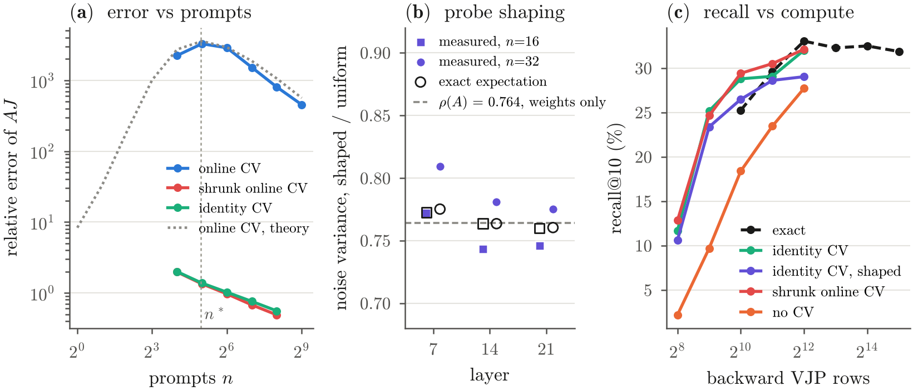

# Workspace Lenses at Small Scale: Reproducing the Jacobian Lens and J++ on Qwen3-0.6B, with Label-Free and Broadcast Variants

*Draft. Author list to be added.*

## Abstract

The Jacobian lens (J-lens) reads an intermediate residual vector of a language model through
the corpus-averaged Jacobian to the final layer. The tokens it surfaces in a mid-depth band
have been argued to behave like the contents of a global workspace. J++ makes these readouts
markedly more faithful in large models. We reproduce the J-lens, the R-Lens and J++ on
Qwen3-0.6B on a single CPU, with the released prompt sets and the J++ evaluation protocol.

**Reproduction.** On held-out items the J-lens recovers 33.2% of latent intermediates at
recall@10, against 27.1% for the logit lens. Its advantage sits in layers 4–19 and on typo
correction. The workspace band chosen by a pre-declared rule is layers 20–24.

**J++ at this scale.** Over 25 fresh splits, J++'s gain over the J-lens averages 6.7 points,
against about 20 at 27B. About two-thirds of it comes from the LRP backward pass (4.5 points) and a
third from the learned expert weights (2.2). Without the correctness filter, the plain LRP R-lens is
ahead of J++.

**Label-free and broadcast variants.**
- A label-free lens routes each residual to its own LRP expert, with count-adaptive shrinkage. It
  comes within 1.6 points of J++ over 25 splits.
- A new *broadcast lens* keeps only influence on strictly later positions, the attention-carried
  traffic a workspace reading identifies with availability. It is weak alone (21.7%), and LRP
  rules raise it by 6 points.

**Pre-registered tests: J++ is not beaten.** Two pre-registered rounds tested improvements over
J++.
- **Round 2** fixed four candidates and ran five fresh splits. Two met the win criterion by small
  margins: bagged J++ weights (+1.0 points, 4/5 wins) and a two-weight mix of the R-lens and the
  broadcast lens (+0.6, 4/5 wins and 1 tie).
- **Round 3** re-tested both, plus an LRP-broadcast mix, on twenty more splits, with 16/20 wins
  required. All three tie J++ (+0.3, −0.4 and −0.4 points; 11, 7 and 9 wins).

Bagging halves J++'s overfitting to its 47 labelled items, but does not raise held-out recall.

**Pitfalls.** We document two implementation pitfalls in J++-style evaluations: empty expert
clusters that score a spurious perfect recall, and masking before combining experts.

**Sketch estimators.** Our planned sketch of the J-lens, with an online control variate, diverges:
its error peaks at about 3,700 times the lens's norm after 32 prompts. A variance recursion we derive
predicts the peak, and a shrunk control variate fixes it. Readout-aware probe shaping cuts sketch
noise by the factor a weights-only formula predicts (0.74–0.81 measured against ρ(A) = 0.764), but
does not improve recall. With independent prompts, no unbiased sketch can beat the exact estimator at
equal cost. Here sketches stay competitive only because consecutive corpus records are correlated.

**Causal swaps.** We swap a templated function's argument (e.g. the country in "The capital of
A is") along lens directions:

| Directions | Success | Band |
|---|---|---|
| J-lens | 28% | readout-selected band (layers 20–24) |
| J-lens | 48% | mid-depth layers 7–20 |
| logit lens | 7–8% | either band |
| random-target null | ≤2% | — |
| J-lens | 43–48% | any 5-layer window in layers 3–19 (exploratory) |

The leverage is concentrated in one category (countries). Equal-width windows show that depth,
not the number of edited layers, sets it: every window from layer 3 to 19 beats the
readout-selected band.

**Ignition.** As one input word is morphed into another, the network sharpens the switch between
competing concepts beyond what a straight-line mix of the endpoint activations predicts. For country
pairs the switch is 0.12–0.16 narrower through layers 12–24, against about 0.05 for unrelated nouns.
The sharpening grows steadily to the output and appears equally in logit-lens readouts. It is not
confined to a J-space band.

## 1 Introduction

Gurnee et al. (2026) introduced the *Jacobian lens* (J-lens): to read what an intermediate
residual-stream vector h_l is disposed to make a language model say, transport it to the final
layer with the corpus-averaged Jacobian J_l = E[∂h_final/∂h_l], then decode it with the model's own
unembedding. The tokens the J-lens surfaces in a contiguous mid-depth band, the *J-space*, behave
like the contents of a global workspace. They are causally used (swapping one concept's lens
coordinate for another's redirects multi-hop answers), selectively and flexibly routed, and show
ignition-like dynamics. These claims were established on Claude models and reproduced on Qwen
3.6 27B. The J++ Lens (Ayonrinde & Lindsey, 2026) then made the readouts markedly more faithful,
raising recall@10 of latent intermediates on Qwen3.6-27B from 35.7% to 55.2%.

Two practical questions remain open. (1) **Does any of this hold in a small model?** If the J-space
is a product of scale, its properties should weaken or vanish at sub-billion scale. If it is a
generic consequence of residual-stream computation, they should persist. (2) **Can the lens be
fitted and read more efficiently?** The reference estimator needs d_model backward passes per
fitting prompt, and J++ additionally needs labelled evaluation items to weight its expert
Jacobians. Both costs are barriers to using workspace lenses as routine tools.

We study both questions on Qwen3-0.6B (28 layers, d_model = 1024) under a deliberately austere
budget: one 4-core CPU, no GPU. Our contributions:

1. **A small-model reproduction with controls.** We reproduce the J-lens, the R-Lens and the J++
   Lens on Qwen3-0.6B with the authors' released prompt sets and scoring conventions. We add a
   ridge-tuned regression-lens baseline, matched-norm random and logit-lens controls for every
   causal swap, and item-level bootstrap intervals throughout. The J-lens's advantage over the
   logit lens is real but concentrated in mid-depth layers and on one evaluation (typos).
2. **J++ at small scale, and two pitfalls.** J++'s gain over the J-lens shrinks from about 20
   points at 27B to 6.7 (mean over 25 splits). About two-thirds of that comes from the LRP backward
   pass and a third from the learned expert weights. We document two implementation
   pitfalls that silently distort J++-style evaluations. With a small fitting corpus, empty expert
   clusters give all-zero maps, which score a spurious perfect recall under the strict rank
   rule. Masking tokens before combining experts penalises negative weight sums.
3. **Label-free alternatives that come close to J++.** Routing each residual through its own LRP
   expert, with count-adaptive shrinkage toward the pooled map, needs no labelled data. It comes within
   1.6 points of J++'s held-out recall over 25 fresh splits.
4. **The broadcast lens.** We define a lens that keeps only influence on strictly *later*
   positions, the attention-carried traffic that a global-workspace reading identifies with
   availability. It is weak on its own but ranks some intermediates no other lens finds. Mixed with the R-lens
   (two weights per layer), it gains mainly on multihop bridge entities.
5. **Two pre-registered, multi-split tests of improvements over J++, with a negative result.**
   Because the released evaluations are small, we pre-register candidate improvements and test them
   on fresh fitting/held-out splits with a stated win criterion.
   - Round 2 (five splits): two candidates meet the criterion by small margins, bagging J++'s
     weights and an R-lens/broadcast mix.
   - Round 3 (twenty new splits): both tie J++, as does an LRP-broadcast mix.

   J++ is not beaten. Bagging halves its overfitting to the 47 labelled items, but does not raise
   held-out recall.
6. **Sketch estimators** of the average Jacobian, whose headline result is negative. They use
   Haar-random probes, the exactly known identity path, control variates and *readout-aware* probe
   shaping. We prove they are unbiased and derive their variance.
   - With independent prompts, no such sketch beats the exact estimator at equal cost.
   - The planned online control variate diverges, as a variance recursion we derive predicts. A
     shrunk version fixes it.
   - A closed-form, weights-only predictor ρ(A) matches the measured gain from shaping, but shaping
     does not improve recall.

We report every comparison, including those our methods lose. Table 0 summarises which claims carry over to 0.6B parameters, and Figure 1 shows the lenses we
compare.

**Table 0.** Claims scorecard: what carries over to Qwen3-0.6B.

| Claim (large models) | Qwen3-0.6B (this work) | Verdict |
|---|---|---|
| The J-lens reads latent intermediates better than the logit lens | 36.7% vs 31.9% recall@10; the advantage lies in layers 4–19 and on typo correction | holds |
| Readable content occupies a contiguous band of layers | readouts peak in layers 20–24 (71–86% of depth), chosen by a pre-declared rule | holds |
| J-lens directions are used causally downstream | argument swaps succeed on 28–48% of trials vs 7–8% for logit-lens directions and ≤2% for an unrelated target; carried by one category | holds, narrowly |
| Causal content is confined to that band | swaps succeed on 43–48% in every 5-layer window from layer 3 to 19, against 28% in the readout band (exploratory) | not at 0.6B |
| Ignition-like, abrupt switching between concepts | the network sharpens competing concepts beyond a linear mix, but progressively with depth and as much through the logit lens | partly |
| Implicit concepts (associations, rhyme plans) are readable | ≤1% recall for every lens; the right concept's median rank is 1,000–2,000 | not at 0.6B |
| J++ makes readouts markedly more faithful (35.7% → 55.2% at 27B) | +6.7 points over the J-lens over 25 splits, about two-thirds from the LRP backward pass | much smaller |
| J++'s learned expert weights add substantially | +2.2 points over the plain LRP lens (25 splits); they overfit 47 labelled items, and no pre-registered change improves on them | modestly |

**Figure 1.** The lenses compared.

- (a) What each lens averages:
  - the J-lens: a residual's influence on the final layer at the same and all later positions;
  - the broadcast lens: later positions only, which removes the identity path and the position's
    own next-token computation;
  - the R-lens: the J-lens average computed through an LRP backward graph.
- (b) Expert-based lenses route a residual to one of eight cluster-specific Jacobians:
  - J++ combines them with signed weights fitted on labelled items;
  - Bagged-J++ averages those weights over bootstrap refits;
  - the routed lens decodes each residual with its own expert and needs no labels.

## 2 Related work

**Lenses on the residual stream.** The *logit lens* (nostalgebraist, 2020) decodes an
intermediate residual with the model's own unembedding; it is uninformative in early and middle
layers, where the representation basis has not yet aligned with the output. The *tuned lens*
(Belrose et al., 2023) learns an affine translator per layer, trained to match the final-layer
distribution. Because it is trained on the model's *current* output, it tends to "skip ahead" to
the imminent prediction rather than expose intermediate variables. *Future Lens* (Pal et al.,
2023) and *Patchscopes* (Ghandeharioun et al., 2024) decode hidden states by learned or
prompted transplantation.

**The Jacobian lens and J-space.** Gurnee et al. (2026) replace the identity transport of the logit
lens with the average input–output Jacobian, J_l = E[∂h_final/∂h_l], estimated over
pretraining-like text, and call the span of the resulting per-token directions the *J-space*.
They argue that J-space content has functional properties of a global workspace (Baars, 1988;
Dehaene & Naccache, 2001): it is causally used downstream, confined to a mid-depth band,
flexibly routed, selective, and capacity-limited. A reference implementation and synthetic prompt
sets are public (anthropics/jacobian-lens). A commentary accompanying the paper reports a
reproduction of the core findings on Qwen 3.6 27B [verify].

**Improving the J-lens.** The *R-Lens* (Blank & Bhatia, 2026 [verify]) computes the Jacobian
through a Layer-wise Relevance Propagation backward graph. The *J++ Lens* (Ayonrinde & Lindsey,
2026) adds *Jacobian filtering*: positions are clustered (k-means, eight clusters per layer), one
expert Jacobian is averaged per cluster, and experts are combined with learned signed weights. J++
also uses the LRP backward pass and *Readout Filtering*, which drops tokens with no letter or
digit from the ranking. On Qwen3.6-27B it raises recall@10 of latent intermediates from 35.7%
(J-lens) to 55.2%. These methods change *what* is averaged. Our contributions are orthogonal: we
change *how cheaply* the average is estimated, and *how* lens logits are ranked.

**Randomized estimation.** Our sketch estimators are instances of classical randomized linear
algebra: Hutchinson-style probing (Hutchinson, 1989), random-projection sketches (Halko,
Martinsson & Tropp, 2011; Martinsson & Tropp, 2020), and importance sampling for approximate
matrix products (Drineas, Kannan & Mahoney, 2006). Control variates for Monte Carlo are textbook
(e.g. Owen, 2013). To our knowledge they have not been applied to estimating workspace lenses.

## 3 Methods

All lenses map a residual h_l at block l to logits unembed(M_l h_l) for a d×d map M_l. The logit lens
uses M_l = I. The J-lens uses M_l = J_l, the corpus-averaged Jacobian of the final residual with
respect to h_l, summed over target positions p′ ≥ p and averaged over source positions p. The R-Lens
computes the same average through an LRP backward graph. J++ fits signed weights over per-cluster
"expert" Jacobians (§4). This section describes what we add.

### 3.1 The broadcast lens: reading what a position sends forward

The reference J-lens averages, over source positions p, the summed sensitivity of the final
residual at every target position p′ ≥ p:

  J_l = E_p [ Σ_{p′ ≥ p} ∂h_L[p′] / ∂h_l[p] ].

The p′ = p term differs in kind from the others. It contains the residual skip path, which
contributes exactly the identity (J_n = I + Δ_n), and the position's own next-token computation.
The terms with p′ > p exist only because later positions *read* position p through attention.
On a global-workspace reading, that cross-position traffic is what makes content "available":
the workspace is defined by broadcast, not by what a position is about to emit itself. The
top-10 lists of the reference lens show the cost of mixing the two. At a sentence-final period,
generic sentence openers (" They", " The", " This", " It") occupy top-10 slots in about a quarter
of fitting-split item–layer cells. These are predictions about the *next token*, not about held
content.

We therefore define the broadcast lens (B-lens) by keeping only strictly later targets:

  B_l = E_p [ Σ_{p′ ∈ T(p)} ∂h_L[p′] / ∂h_l[p] ],  with every p′ ∈ T(p) satisfying p′ > p.

The diagonal cannot be removed from a single target-summed backward pass: one VJP returns, for
every source position, its total over all targets. So we split each record's valid positions
(16 … T−2) into halves. Sources are the first half, and the one-hot cotangent is placed on every
position of the second half. Every term then has p′ > p, the identity path is absent, and the
cost per prompt is the same d VJPs as the reference estimator. We verified the estimator against
the brute-force Jacobian of a small random Qwen3 model (relative error ≈ 1e-7).

Two properties are worth noting. First, lens logits are invariant to rescaling the map, so the
different number of summed targets per source does not matter. Second, the B-lens needs no labels
and no extra machinery. It is a different *definition* of the lens, not a fitted correction.
Because J++'s expert-weight search accepts any set of candidate maps, we also report *JB-mix*,
per-layer signed weights over the Frobenius-normalised J_l and B_l. It comes in a labelled version
(fitting split, as for J++) and a label-free version (future tokens, as for SS-J++).

### 3.2 Label-free Jacobian filtering

J++'s largest single gain comes from *Jacobian filtering*. Source positions are clustered, one
expert Jacobian J_{l,e} is averaged per cluster, and the lens uses J_l = Σ_e w_{l,e} J_{l,e}. The
signed weights are chosen per layer to maximise recall@10 of known intermediates on a labelled
fitting split of the evaluation prompts. The weights thus depend on labelled data from the same
distribution the lens is scored on. That is a reasonable choice for a benchmark, but a barrier for a
tool meant to read *unknown* content.

We replace the labels with the definition of the J-lens itself. J_l measures how the residual at a
position influences the final-layer state summed over all *future* positions, i.e. what the model is
disposed to say later. On unlabelled text we know what was said later. For held-out corpus
positions p we take as candidates the set of semantic tokens (containing a letter or digit) among
t_{p+1}, …, t_{p+16}, and fit w_l with J++'s exact search and surrogate. We use 200 positions from
WikiText-103 records disjoint from all fitting and evaluation data. Everything else (experts,
router, number of starts and steps, Readout Filtering) is unchanged. We call the result *SS-J++*
(LRP experts) or *SS-J-filt* (plain experts).

### 3.3 Routed expert lens

J++ collapses its experts into a single map per layer, keeping inference cost at one matrix–vector
product. The router that defines the clusters is itself cheap: a 64-dimensional projection and a
nearest-centroid lookup. The *routed* lens decodes each residual through the expert of its own
cluster, unembed(J_{l,c(h)} h). It needs no labelled data. Because each expert is averaged over
only about 1/E of the positions, we also consider shrinkage toward the pooled Jacobian,
J_{l,e}(λ) = λ J_{l,e} + (1 − λ) J̄_l. We consider λ ∈ {0.5, 1} and a count-adaptive
λ_e = n_e/(n_e + κ) with κ = 200, where n_e is the number of fitting positions expert e saw. The
variant is selected on the fitting split.

### 3.4 Sketch estimators of the Jacobian lens

**Setup.** For a prompt n with valid positions P (positions ≥ 16, excluding the last), the
reference estimator computes the target-summed, source-averaged Jacobian

  J_n = |P|⁻¹ Σ_{p∈P} Σ_{p'∈P} ∂h_L[p'] / ∂h_l[p]  ∈ ℝ^{d×d},

one row block at a time. A one-hot cotangent e_i, placed at every target position, returns row i
at every source position in a single vector–Jacobian product (VJP), and does so for all source
layers at once. The lens is J = N⁻¹ Σ_n J_n. Each prompt costs d VJPs: 1,024 for Qwen3-0.6B and
5,120 for a 27B model. This cost dominates fitting.

**Observation 1 (exact identity path).** The p' = p term contains the residual connection, so
J_n = I + Δ_n, where Δ_n collects the derivatives of the block updates. The identity part needs no
estimation.

**Estimator.** Draw a Haar-random Q ∈ ℝ^{d×K} with orthonormal columns. Fix a symmetric
positive-definite *shaping* matrix W and a *control variate* J₀ that is independent of
(Q, prompt n). Compute the K VJPs G = (WQ)ᵀ J_n and set

  Ĵ_n = J₀ + (d/K) W⁻¹ Q (G − (WQ)ᵀ J₀).

**Proposition 1 (unbiasedness).** E[Ĵ_n | J₀] = E[J_n].
*Proof.* E[QQᵀ] = (K/d) I for a Haar K-frame, so E[(d/K) W⁻¹QQᵀW (J_n − J₀)] = J_n − J₀. ∎

This holds for any J₀ built from *previous* prompts and probes, including the running mean of
earlier estimates (the "online" control variate). Unbiasedness says nothing about variance,
however, and Proposition 3 shows that the online control variate's variance explodes.

**Proposition 2 (variance, W = I).** For any M ∈ ℝ^{d×d},
E‖(d/K) QQᵀ M − M‖²_F = (d/K − 1) ‖M‖²_F. Hence each prompt contributes variance
σ² + (d/K − 1)·E‖J_n − J₀‖²_F, where σ² = E‖J_n − E J_n‖²_F.

*Consequences.* (i) Without a control variate, the sketch pays (d/K − 1)·‖J_n‖², which is
dominated by the large mean ‖E J_n‖². (ii) J₀ = I removes the identity path exactly.

**Corollary (no sketch beats the exact estimator at equal cost).** With independent prompts and
a fixed J₀, a budget of R VJP rows buys R/d exact prompts or R/K sketched ones, with variances

  exact: σ² d/R,   sketch: (d/R)·[σ² + (1 − K/d)‖E J_n − J₀‖²_F].

Their ratio is 1 + (1 − K/d)‖E J_n − J₀‖²/σ² ≥ 1. It approaches 1 only as J₀ approaches the lens
itself. For Qwen3-0.6B with J₀ = I, the ratio is 2.1, 3.3 and 5.7 at layers 7, 14 and 21 (§5.7).
Under independent prompts, sketching therefore cannot reduce variance at equal cost. It can only
(a) give *anytime* estimates below the d rows of one exact prompt, (b) spread a fixed budget over
d/K times as many *distinct* prompts, which helps when nearby prompts are correlated (§5.7), and
(c) *shape* the probes (Proposition 4).

**Proposition 3 (the online control variate is unstable).** Let W = I and c = d/K − 1. Use J₀ = I
for the first prompt and J₀ = J̄_n, the mean of the first n estimates, afterwards. Let
v_n = E‖J̄_n − E J_n‖²_F. Then

  v₁ = (c + 1)σ² + c‖E J_n − I‖²_F,   v_{n+1} = [(n² + c)·v_n + (c + 1)σ²] / (n + 1)².

*Proof.* The new estimate's error is (J_{n+1} − E J) + ((d/K)QQᵀ − I)(J_{n+1} − J̄_n).
Conditional on the past, both terms have mean zero and are uncorrelated with each other and with
J̄_n − E J. Proposition 2 gives the second term's variance, c·(σ² + v_n). Averaging into the
running mean gives the recursion. ∎

The coefficient on v_n, (n² + c)/(n + 1)², exceeds 1 while n < (c − 1)/2. The running-mean error
therefore *grows* for the first ≈ d/(2K) prompts: for d/K = 64 it grows through n = 31, by a
factor of 1.8 × 10⁵ in variance (430 in norm) on top of the first prompt's error. Only then does it
decay, roughly as 1/n in variance. The mechanism is that each sketched prompt re-amplifies the
current error of J₀ by (d/K − 1), and early on the running mean holds too few prompts to dilute it.

*Fix (shrunk online control variate).* Use J₀ = I + λ_n(J̄_n − I) with λ_n = n/(n + d/K). The
recursion keeps its form, with c·v_n replaced by c(λ_n² v_n + (1 − λ_n)²‖E J_n − I‖²). The
coefficient (n² + cλ_n²)/(n + 1)² is below 1 for every n, so the error never grows. Like the plain
online control variate, it approaches the exact estimator's cost per row as n grows. We derived
this fix after the online control variate diverged (§5.7), so its test is exploratory.

**Proposition 4 (readout-aware shaping).** Readouts and swap directions use only the J-space
dictionary A J, where A = W_U diag(g) is the unembedding with the final-norm gain folded in.
For Gaussian probes, the leading term of E‖A(Ĵ_n − J_n)‖²_F is
K⁻¹ tr(W M Mᵀ W) · tr(W⁻¹ AᵀA W⁻¹), with M = J_n − J₀. Over symmetric PD W, with an
isotropic prior on M (MMᵀ ∝ I), this is minimised by W = (AᵀA)^{1/4}. The variance relative to
W = I is reduced by the factor

  ρ(A) = (Σ_i s_i)² / (d Σ_i s_i²) ≤ 1,

where s_i are the singular values of A. Equality holds only for a flat spectrum. *Proof sketch.*
Write Z = W². By the Cauchy–Schwarz inequality for the trace inner product,
tr(Z) tr(Z⁻¹AᵀA) ≥ (tr (AᵀA)^{1/2})², with equality at Z ∝ (AᵀA)^{1/2}. ∎
(Without the isotropy assumption, the optimum is the matrix geometric mean of (MMᵀ)⁻¹ and
AᵀA, which a pilot estimate of MMᵀ can approximate.)

ρ(A) can be computed from the weights alone. It *predicts* the benefit of shaping before any
Jacobian is computed.

### 3.5 Ideas that did not work

We report three readout modifications that we expected to help. On the fitting split, two hurt
and one made no difference.

*Per-token calibration.* We ranked tokens by the z-score (or centred value) of their lens logit
relative to corpus statistics, to remove the context-independent prior. For the n = 8 J-lens,
recall@10 over all layers fell from 0.369 (raw) to 0.281 (centred) and 0.267 (z-scored). It fell
for the logit lens too (0.319 → 0.280). The prior that calibration removes evidently carries
signal: many latent intermediates are frequent, generic words.

*Affine Taylor transport.* The J-lens linearises around zero, J h = J(h − μ_l) + J μ_l. A
first-order expansion around the corpus mean instead gives μ_L + J(h − μ_l). On the fitting split
this lowered recall@10 from 0.343 to 0.280 (correctness-filtered items) and from 0.247 to 0.163
(all items). Dropping the offset entirely ("centred") was also worse. ‖μ_L‖ = 459, against
‖J μ_l‖ = 119 at layer 14, with cosine 0.83. Replacing the transported mean by the true
final-layer mean over-weights the generic output direction.

*Surface-form collapsing.* Top-10 lists often spend several slots on one word ("December",
" December", " december"). The evaluation credits a candidate through its best surface form but
makes it compete against every variant of every competitor. We therefore collapsed each class of
tokens that agree after dropping one leading space and lowercasing (37,912 tokens in multi-member
classes) into one canonical entry carrying the class maximum. The canonical member is fixed by the
vocabulary as the first of " "+lower, lower, " "+Capitalised, Capitalised that exists, which is
always one of a candidate's credited forms. We checked this for all 3,930 candidate ids, with no
exception. Fitting-split recall@10 was unchanged (J-lens 0.364 → 0.364; logit lens 0.311 →
0.311). The duplicated variants are almost always variants of the *correct* concept, which
already outranks the candidate's competitors.

### 3.6 Candidate improvements to J++

J++ chooses eight signed weights per layer to maximise recall on about 50 labelled items. Its
fitting-split recall far exceeds its held-out recall (§5.2). We therefore designed candidates
that either stabilise the weight search or feed it better maps. All of them use J++'s own search
(exact recall@10 with a sigmoid-margin surrogate, three starts, 200 Adam steps) on the same
fitting items. Maps entering a mix are first scaled to unit Frobenius norm, so the weights
compare directions rather than scales.

*Bagged-J++* refits the J++ weights on B = 8 bootstrap resamples of the fitting items, drawn
separately within each evaluation. It averages the B weight vectors and renormalises the average
to unit length. Averaging reduces the variance of a search whose objective, recall over a few
dozen items, is a step function of the weights.

*RB-mix* fits two signed weights per layer over the R-lens and the B-lens (§3.1). It has fewer
weights than J++ (2 against 8). Its two maps differ in kind rather than in cluster: total
influence through the LRP graph, and influence on later positions only.

*JppB* is two-stage. It first fits J++, then fits two weights over the J++ map and the B-lens.

*Routed-J++* routes each residual to its own LRP expert (§3.3), shrunk toward the fitted J++ map
instead of the pooled map, with λ_e = n_e/(n_e + 200).

*RLB-mix* (round 3) is RB-mix with the B-lens replaced by an *LRP broadcast lens*: the broadcast
estimator of §3.1 run through the R-Lens's LRP backward rules. At this scale the LRP rules account
for about two-thirds of J++'s gain over the J-lens (§5.4). The question is whether they help the
broadcast map too.

Round 2 fixed the first four candidates, and round 3 fixed RLB-mix, each in a committed
pre-registration before any of its numbers were computed.

## 4 Experimental setup

**Model and hardware.** Qwen3-0.6B (post-trained checkpoint `Qwen/Qwen3-0.6B`; 28 decoder blocks,
d_model = 1024, vocabulary 151,936, tied embeddings), in bf16, on one 4-core Intel Xeon CPU with
AMX, 15 GB RAM, no GPU. Chat prompts use the model's template with thinking disabled. Layer l means
the output of block l; the target layer is block 27, before the final RMSNorm.

**Fitting corpus.** WikiText-103 (raw) training records of at least 600 characters, truncated to
128 tokens, as in the reference implementation. Fitting uses records 0–31 (exact) or 0–511
(sketches). Router fitting, calibration statistics and the regression lens use 12,288 positions
(48 random positions ≥ 16 from each of records 5000–5255), disjoint from the fitting prompts.

**Lenses.**
*Logit lens*: identity transport.
*Regression lens*: ridge least squares from h_l to h_27 on corpus positions, with the ridge chosen
per layer on held-out R² (0.21 at layer 0, rising to 0.75 at layer 24). It is a tuned-lens-style
baseline trained on the model's *current* output.
*J-lens*: exact reference estimator over 32 prompts (32 × 1,024 VJPs).
*R-lens*: the same, with the backward graph under the LRP rules of J++ ("rlens" scope: LN-rule on
residual RMSNorms, identity rule on SiLU, half rule on the gate×up product).
*J-filt / J++*: per-layer router (unit-normalise, PCA to 64 dimensions, k-means with E = 8), expert
Jacobians as position-weighted per-cluster means from the same backward passes, and signed
unit-norm expert weights fitted per layer by J++'s smooth-surrogate objective on the fitting split.
J-filt uses plain gradients and J++ uses LRP gradients. As in the reference implementation, an
expert that saw fewer than 50 positions is replaced by the pooled Jacobian. With 32 fitting
prompts this happens for one cluster at each of layers 20–26. Without the fallback, the empty
clusters give all-zero maps whose logits all tie, and under the strict rank rule an all-zero map
scores a spurious recall of 1.0. We hit this bug in a first run and now flag any lens whose
fitting-split recall is 1.0.
*Routed* (ours): each residual is decoded through the expert of its own cluster.
*Weight-search fidelity.* Our round-1 port of J++'s weight search deviated from the reference
search (`workspace_lens.fitting.condense_experts`) in three small ways. It masked excluded tokens
to −10⁴ in each expert before combining, rather than to −∞ after. It took the surrogate's spread
over non-excluded tokens rather than the full vocabulary. It broke ties between iterates by order
rather than by surrogate value. Rounds 2 and 3 (§5.3–5.4) use a faithful port for J++ and for every
candidate, and round 2's seed-0 run gives faithful-port numbers on the round-1 split.
*B-lens* (ours): the broadcast lens of §3.1, fitted on the same first 8 corpus prompts as the
J-lens's n = 8 snapshot (the J-lens's recall is flat from n = 8 to n = 32; §5.1).

**Readout evaluation.** The six released lens-eval prompt sets (multihop, multilingual, poetry,
association, typo, order-ops). Readout positions, single-token surface forms (with/without a leading
space; original, capitalised and lowercase casing; order-ops synonyms) and min-over-surfaces ranks
follow the released READMEs and the J++ code. Items count only if the model's greedy next token
matches the target (multihop, multilingual, order-ops) or the rhyme word (poetry); association and
typo items are always kept. For Qwen3-0.6B this leaves 14/84 multihop, 15/107 multilingual, 8/98
poetry, 99/99 association and 96/96 typo items (and 18/55 order-ops, reported separately). We
therefore also report a pre-declared secondary analysis *without* the correctness filter.
*Recall@k* is computed per item (the fraction of an item's intermediates whose best rank over
layers is ≤ k), macro-averaged over the five macro evals. We also give J++'s pair-level weighting.
Following J++, the head-to-head comparison uses the best rank over seven evenly spaced layers
(4, 7, 11, 14, 18, 21, 24), a stratified 20% fitting / 80% held-out split (seed 0), and scores on
held-out items only. Intervals are 95% item-level bootstrap intervals. Differences between lenses
use a paired bootstrap over items.

**Model selection.** Every readout choice (raw, centred, or z-scored logits, with or without
Readout Filtering) is selected on the *fitting* split, the same labelled items J++ uses to fit its
weights. The held-out split is used only for reporting.

## 5 Results

### 5.1 The J-lens on a 0.6B model

**Readout recall.** Table 1 reports recall@10 of latent intermediates, using the best rank over all
27 block outputs and correctness-filtered items. The J-lens recovers 36.7% of intermediates
(macro; 95% CI 31.4–41.8%), against 31.9% for the logit lens and 16.0% for the ridge regression
lens. With Readout Filtering the figures are 39.2% for the J-lens and 33.5% for the logit lens. The
advantage is concentrated in one eval: on typo items the J-lens recovers the corrected word 77%
of the time, against 47% for the logit lens. On multihop and multilingual items the two lenses
are statistically indistinguishable at this sample size (14 and 15 items).

**Table 1.** Recall@10 (best of layers 0–26, correctness-filtered items, 95% item bootstrap CI on
the macro).

| Lens | multihop (14) | multilingual (15) | typo (96) | association (99) | poetry (8) | macro |
|---|---|---|---|---|---|---|
| logit lens | 0.750 | 0.378 | 0.469 | 0.000 | 0.000 | 0.319 [0.265, 0.365] |
| regression lens | 0.250 | 0.311 | 0.240 | 0.000 | 0.000 | 0.160 [0.114, 0.212] |
| J-lens (n = 32) | 0.679 | 0.383 | 0.771 | 0.000 | 0.000 | 0.367 [0.314, 0.418] |
| logit lens + RF | 0.750 | 0.417 | 0.500 | 0.010 | 0.000 | 0.335 [0.280, 0.383] |
| J-lens + RF | 0.750 | 0.400 | 0.802 | 0.010 | 0.000 | 0.392 [0.340, 0.441] |

RF = Readout Filtering (non-alphanumeric tokens removed from the ranking).

**Where the two lenses differ.** The all-layer maximum hides the mid-depth picture (Figure 2). In
layers 4–19 the logit lens is near floor (single-layer recall@10 between 0.004 and 0.036). The
J-lens recovers 5–11% there, three to eight times more, and peaks at layer 24 (26.2%, against 19.9%
for the logit lens). In the last layers both lenses read out the imminent answer, which is why
their best-of-layers scores converge on the multihop and multilingual sets, where the
intermediate is often close to the output.

**Figure 2.** Single-layer recall@10 for the logit, regression and J-lens. The shaded region is the
workspace band selected by the pre-declared rule (layers 20–24).

**The workspace band.** Our pre-declared rule takes the contiguous run of layers around the peak
of the J-lens curve on which recall stays above half the peak, excluding the three
output-adjacent layers. It selects layers 20–24, about 71–86% of depth. Restricted to this band,
recall@10 is 23.4% for the J-lens against 18.7% for the logit lens (25.5% vs 20.3% with Readout
Filtering).

**Association and poetry are beyond this model.** No lens recovers more than 1% of association
intermediates, and none recovers a poetry rhyme plan. This is not a scoring artefact. The median
best rank of the correct association concept is about 1,000–2,000 across lenses (10th percentile about 200), and the median
poetry rhyme rank is around 300–440. A 0.6B model evidently does not represent these implicit
concepts at the readout position in a form any linear readout of the unembedding recovers. All
lens differences below therefore come from the multihop, multilingual and typo sets.

**Fitting budget.** The J-lens saturates early. Fitted on 8 prompts (8,192 VJPs, about 25 minutes
on our CPU), it scores 36.9% recall@10 (39.9% with Readout Filtering), the same as with 32 prompts.
At this model size the corpus-averaged Jacobian is well determined by a few thousand source
positions.

### 5.2 Head-to-head with J++ (round 1)

Table 2 gives held-out recall@10 under the J++ protocol: correctness-filtered items, 47 fitting
and 203 held-out items, best rank over seven layers, and Readout Filtering. For every lens the
fitting split selected the Readout-Filtered readout.

Figure 3 shows the same comparison graphically, with the all-items panel described at the end
of this section.

**Figure 3.** Round 1 held-out recall@10 with 95% item-bootstrap intervals, for
correctness-filtered items (left) and all items (right).

**Table 2.** Round 1, split seed 0. Held-out macro item recall@10 with 95% item-bootstrap CI.
The last column is the paired difference against J++ on the same items.

| Lens | labels? | fit split | held-out | Δ vs J++ [95% CI] |
|---|---|---|---|---|
| logit lens | no | 0.311 | 0.271 [0.206, 0.330] | −0.104 [−0.159, −0.048] |
| regression lens | no | 0.232 | 0.151 [0.100, 0.207] | −0.223 [−0.285, −0.167] |
| J-lens | no | 0.364 | 0.332 [0.266, 0.393] | −0.042 [−0.095, +0.012] |
| R-lens | no | 0.450 | 0.365 [0.302, 0.425] | −0.010 [−0.060, +0.042] |
| J-filt (plain experts + weights) | yes | 0.483 | 0.354 [0.288, 0.417] | −0.021 [−0.078, +0.036] |
| **J++** | yes | 0.500 | **0.374** [0.311, 0.434] | — |
| SS-J++ (ours, future tokens) | no | 0.385 | 0.331 [0.269, 0.390] | −0.043 [−0.080, +0.002] |
| Semi-J++ (ours) | yes | 0.483 | 0.364 [0.301, 0.423] | −0.011 [−0.029, +0.007] |
| Routed (plain, λ = 0.5) | no | 0.375 | 0.326 [0.262, 0.386] | −0.049 [−0.094, −0.013] |
| Routed-LRP (λ = 0.5)† | no | 0.450 | 0.369 [0.309, 0.428] | −0.005 [−0.057, +0.046] |
| Routed-LRP (adaptive, κ = 200) | no | 0.450 | 0.373 [0.312, 0.433] | −0.001 [−0.053, +0.050] |
| B-lens (ours) | no | 0.118 | 0.217 [0.157, 0.279] | −0.157 [−0.228, −0.085] |
| JB-mix (ours) | yes | 0.364 | 0.368 [0.307, 0.426] | −0.006 [−0.067, +0.058] |
| SS-JB-mix (ours) | no | 0.311 | 0.314 [0.248, 0.375] | −0.060 [−0.115, −0.005] |

† The variant the fitting split selected within the Routed-LRP family (λ = 0.5 and κ = 200 tie
on the fitting split; λ = 0.5 comes first).

**J++ is the strongest lens on this split, but by less than at scale.** J++ reaches 37.4% held-out recall@10,
against 33.2% for the J-lens. Ayonrinde & Lindsey report 35.7% → 55.2% on Qwen3.6-27B. Here the
gain is +4.2 points and its CI includes zero. Most of it comes from the LRP backward pass (J-lens
→ R-lens, +3.3 points). Jacobian filtering with learned weights adds +1.0 point (R-lens → J++).
The weights fit the 47 fitting items much better than they generalise: fitting-split recall is
0.500, against 0.374 held out. Over 25 fresh splits (§5.3–5.4), J++ leads the R-lens by 2.2 points,
so about a third of its gain comes from the learned weights.

**On this split, labels are not needed to match J++.** Routing each residual through its own
LRP expert, shrunk toward the pooled map, needs no labelled data. It matches J++ to within a
point (−0.005 for the variant the fitting split selected, −0.001 for count-adaptive shrinkage;
both CIs about ±0.05). Learning the expert weights from future tokens instead of labels (SS-J++)
recovers only the J-lens level (0.331). The semi-supervised variant is indistinguishable from J++
(−0.011 [−0.029, +0.007]). Over 25 fresh splits, though, the routed lens trails J++ by 1.6 points
(§5.4).

**The broadcast lens alone loses information but complements the J-lens.** Removing the
self-target terms cuts the lens's recall by a third (0.332 → 0.217). Removing the identity path evidently costs
more than the generic next-token predictions it suppresses. The B-lens does rank some
intermediates better than every other lens, for example "Earth" (rank 3, against 9–16) and the
language name "Dutch" (56, against 81–793). A labelled two-map mix of the J-lens and the B-lens (JB-mix) raises
held-out recall from 0.332 to 0.368, close to J++ with only two weights per layer instead of
eight. The fitting split does not show this gain (0.364 for both), so round 1 cannot tell
whether it is real. Over five fresh splits it mostly is not (§5.3).

**Where lenses differ.** Every lens scores 0 on association and poetry held-out items. All
differences come from 12 multihop, 12 multilingual and 77 typo items:

- J++ vs the J-lens: typo 0.857 vs 0.701, multilingual 0.431 vs 0.375, multihop the same
  (0.583).
- JB-mix is the only lens that recovers an extra multihop intermediate (0.667).

**All-items panel (secondary).** The correctness filter leaves only about a dozen held-out items
each on multihop and multilingual. We therefore repeated round 1 without it, on all 539 scored
items (105 fitting, 434 held-out, same split rule), as a pre-declared secondary analysis
(`results/jpp_compare_main_all.json`).

Every lens scores lower, since many items now involve answers the model gets wrong. The R-lens
is the best lens here, *above* J++:

| Lens | held-out recall@10 | Δ vs J++ [95% CI] |
|---|---|---|
| R-lens | 0.335 | +0.009 [−0.007, +0.026] |
| J++ | 0.326 | — |
| Semi-J++ | 0.322 | −0.005 [−0.015, +0.005] |
| Routed-LRP (κ = 200) | 0.318 | −0.009 [−0.025, +0.008] |
| JB-mix | 0.291 | −0.035 [−0.061, −0.010] |
| J-lens | 0.283 | −0.043 [−0.066, −0.021] |
| logit lens | 0.206 | −0.120 [−0.149, −0.090] |
| B-lens | 0.153 | −0.174 [−0.208, −0.139] |

Learning expert weights on the 105 fitting items does not beat the plain LRP map.

Like the rest of round 1, this panel used the earlier port of the weight search (§4).

### 5.3 Round 2: pre-registered candidates on five fresh splits

Round 1 used one split, and its held-out items had already been looked at when we designed
improvements. Round 2 therefore tests four candidates fixed in advance (§3.6, `prereg_round2.md`):

- JppB;
- RB-mix;
- Routed-J++-a200;
- Bagged-J++.

The test uses five fresh stratified splits (seeds 1–5). On each split every label-dependent
weight is refitted on that split's 47 fitting items, and every lens is scored on its 203
held-out items. All weight searches use the faithful port of J++'s search (Amendment 1).

A candidate "beats J++" only if its mean paired difference over the five splits is positive *and*
it wins on at least four of them.

**Table 3.** Round 2. The first three numeric columns cover the confirmatory splits (seeds 1–5):

- mean held-out macro item recall@10;
- mean paired difference vs J++ on the same split, with the range over splits in brackets;
- number of splits on which the lens beats J++.

The last column is the faithful-port held-out score on the round-1 split (seed 0), which is
excluded from the confirmatory summary. Rows marked * are the pre-registered candidates.

| Lens | labels? | mean held-out | mean Δ vs J++ [range] | wins | seed 0 |
|---|---|---|---|---|---|
| logit lens | no | 0.285 | −0.107 [−0.127, −0.083] | 0/5 | 0.271 |
| J-lens | no | 0.338 | −0.055 [−0.084, −0.036] | 0/5 | 0.332 |
| R-lens | no | 0.386 | −0.006 [−0.023, +0.010] | 2/5 | 0.365 |
| B-lens | no | 0.210 | −0.183 [−0.204, −0.173] | 0/5 | 0.217 |
| Routed-LRP (λ = 0.5) | no | 0.390 | −0.002 [−0.019, +0.014] | 2/5 | 0.369 |
| Routed-LRP (adaptive, κ = 200) | no | 0.393 | +0.000 [−0.015, +0.014] | 3/5 | 0.373 |
| **J++** | yes | 0.392 | — | — | 0.367 |
| JB-mix | yes | 0.347 | −0.045 [−0.076, −0.026] | 0/5 | 0.362 |
| JppB* | yes | 0.396 | +0.004 [−0.017, +0.029] | 3/5 | 0.386 |
| Routed-J++-a200* | yes | 0.380 | −0.013 [−0.034, −0.003] | 0/5 | 0.348 |
| **RB-mix*** | yes | 0.398 | **+0.006** [+0.000, +0.023] | **4/5** (+1 tie) | 0.395 |
| **Bagged-J++*** | yes | **0.403** | **+0.010** [−0.030, +0.058] | **4/5** | 0.384 |

**Two candidates meet the criterion, by small margins.**

- **Bagged-J++** refits J++'s weights on eight stratified bootstrap resamples of the fitting
  items and averages them. It gains 1.0 point on average and wins on four of five splits.
- **RB-mix** fits two signed weights per layer over the unit-normalised R-lens and B-lens maps.
  It gains 0.6 points, wins on four splits, ties on the fifth, and is never behind J++.
- **JppB** (+0.4, 3/5) and **Routed-J++-a200** (−1.3, 0/5) do not meet the criterion.

By the rule we fixed in advance, Bagged-J++ and RB-mix beat J++ on this benchmark (Figure 4). Round 3
(§5.4) re-tested both on twenty more splits, and neither replicated.

**Figure 4.** Round 2: held-out recall@10 minus J++'s on the same split, for each of the five
confirmatory splits (dots), with the mean (bar). Split wins are on the right, in bold where the
pre-registered criterion is met. Shaded rows are the pre-registered candidates.

**The margins are small relative to the noise. We read them as "at least as good as J++", not
as a clear improvement.** Three facts argue for caution:

- **Per-split intervals.** RB-mix's paired 95% intervals include zero on every split.
  Bagged-J++'s exclude zero on two splits, but in opposite directions: +0.058 [+0.004, +0.124] on
  seed 4 and −0.030 [−0.069, −0.004] on seed 5.
- **Near-cancelling wins.** Three of RB-mix's four wins are below +0.002 in macro recall. Each is
  the net of gains and losses that nearly cancel. On seed 1, for example, RB-mix gains on
  multihop (+0.083) and typo (+0.039) but loses on multilingual (−0.104).
- **Overlapping splits.** Every split's held-out set is 80% of the same 250 items, so four wins
  out of five is weaker evidence than four independent replications.

**What bagging changes is J++'s overfitting.** J++'s per-layer search over eight signed weights,
with 47 fitting items, fits the fitting items well and generalises less well.

- Unfitted lenses score *lower* on the fitting items than on the held-out items: the R-lens gets
  0.340 against 0.386, so the fitting items happen to be about 4.6 points harder.
- Against that baseline, J++ is optimistic on its fitting items by about 14 points
  (0.484 against 0.392 held out).
- Bagged-J++ is optimistic by about 9 points (0.448 against 0.403).
- RB-mix, with two weights per layer, is optimistic by about 6 points (0.416 against 0.398).

The candidates that do well are those that give the 47 labelled items the least room to overfit.

**Where RB-mix gains.** RB-mix's advantage is concentrated in multihop:

- It improves on J++'s multihop recall on four of the five confirmatory splits (+0.04 to +0.17)
  and ties on the fifth.
- It scores below J++ on multilingual on three of them.

The fitted B-lens weight is positive at every layer from 11 onward on average:

| Layer | 11 | 14 | 18 | 21 | 24 |
|---|---|---|---|---|---|
| mean B-lens weight | 0.18 | 0.33 | 0.27 | 0.30 | 0.49 |

The R-lens weight is about 0.8–1.0, and both maps are unit-normalised. This matches round 1's
qualitative finding that the broadcast lens ranks some bridge entities that the other lenses
miss.

**What does not replicate.** Round 1's JB-mix gain over the J-lens (0.332 → 0.368 on seed 0) was
mostly a property of that split.

- Over seeds 1–5 JB-mix improves on the J-lens by only 0.010 on average (range −0.005 to +0.029),
  and trails J++ by 4.5 points.
- The B-lens adds to the R-lens (RB-mix) but barely to the J-lens.

**The faithful port and the round-1 split.** On seed 0 the faithful port gives J++ 0.367,
against 0.374 with the round-1 port. The difference is within noise, but it reorders the
round-1 comparison: the label-free routed LRP lens (0.373) is now 0.6 points *above* J++ on
that split. Over seeds 1–5 it ties J++ exactly on average (+0.000, 3/5 wins).

**How much do learned weights add at this scale?** Across these five splits J++ improves on the
J-lens by 5.5 points (range 3.6–8.4) but on the R-lens by only 0.6 (range −1.0 to +2.3). On these
splits alone, almost all of J++'s advantage seemed to come from the LRP backward pass. Round 3
(§5.4) revises this: over twenty more splits the expert weights add 2.6 points, about a third of
J++'s gain.

### 5.4 Round 3: the round-2 winners do not replicate

Round 2's two winners had margins smaller than a single split's paired interval, measured on five
splits that share most of their items. Round 3 re-tests them on twenty new splits (seeds 6–25),
under a pre-registration committed before any round-3 number existed (`prereg_round3.md`):

- Bagged-J++ and RB-mix, unchanged;
- one new candidate, RLB-mix: RB-mix with the broadcast lens computed through the LRP backward rules.

A candidate beats J++ only with a positive mean paired difference *and* at least 16 wins in 20.

**Table 5.** Round 3: twenty splits, each with 47 fitting and 203 held-out items. Out-of-pool
columns score the same fitted lenses on the 289 items that fail the correctness filter, which round 2
never scored. Rows marked * are the pre-registered candidates.

| Lens | labels? | mean held-out | mean Δ vs J++ [range] | wins/ties/losses | out-of-pool | Δ out-of-pool |
|---|---|---|---|---|---|---|
| Bagged-J++* | yes | **0.407** | +0.003 [−0.029, +0.054] | 11/1/8 | 0.223 | −0.005 |
| RB-mix* | yes | 0.401 | −0.004 [−0.063, +0.035] | 7/0/13 | 0.223 | −0.006 |
| RLB-mix* | yes | 0.400 | −0.004 [−0.072, +0.044] | 9/0/11 | 0.219 | −0.009 |
| **J++** | yes | 0.404 | — | — | 0.228 | — |
| routed LRP (κ = 200) | no | 0.385 | −0.019 [−0.080, +0.033] | 3/0/17 | 0.201 | −0.028 |
| R-lens | no | 0.378 | −0.026 [−0.088, +0.027] | 3/0/17 | **0.238** | +0.009 |
| J-lens | no | 0.334 | −0.070 [−0.127, −0.036] | 0/0/20 | 0.202 | −0.026 |
| logit lens | no | 0.275 | −0.129 [−0.187, −0.094] | 0/0/20 | 0.153 | −0.076 |
| LRP broadcast lens | no | 0.269 | −0.135 [−0.205, −0.089] | 0/0/20 | 0.117 | −0.111 |
| broadcast lens | no | 0.207 | −0.197 [−0.260, −0.154] | 0/0/20 | 0.060 | −0.168 |

**Figure 5.**

- (a) Round 3: each lens's held-out recall@10 minus J++'s on each of twenty splits (dots), with the
  mean (bar) and split wins.
- (b) Where J++'s gain over the J-lens comes from, as means over all 25 splits of rounds 2 and 3:
  - the LRP backward pass (J-lens → R-lens);
  - learned expert weights (R-lens → J++);
  - bagging (J++ → Bagged-J++).

  Brackets give each step's range over splits.

**No candidate beats J++.**

- Bagged-J++ is ahead by 0.3 points on average and wins 11 of 20 splits.
- RB-mix and RLB-mix trail by 0.4 points and win 7 and 9.
- None comes near the 16 wins required.
- The per-split intervals exclude zero for Bagged-J++ on 3 splits, and against RB-mix on 3.

Round 2's small wins were within noise. On this benchmark at 0.6B, nothing we tried beats J++ under
its own protocol.

**Bagging curbs overfitting without improving held-out recall.** J++ scores 9.8 points higher on
its fitting items than held out, against 4.0 for Bagged-J++ and RB-mix and about 1 for unfitted
lenses. The weights are less overfitted but generalise no better.

**Learned weights add more than round 2 suggested.** Over these twenty splits J++ beats the R-lens
by 2.6 points, on 17 of 20 splits (range −2.7 to +8.8). Pooled over all 25 splits of rounds 2 and 3
(Figure 5b), J++'s 6.7-point gain over the J-lens splits into:

- 4.5 points from the LRP backward pass;
- 2.2 points from the expert weights.

The LRP backward pass is therefore about two-thirds of J++'s gain, not nearly all of it as round 2's
five splits suggested.

**The label-free routed lens trails J++.** It tied J++ in round 2, but here it trails by 1.9 points,
with J++ ahead on 17 of 20 splits. Over all 25 splits it trails by 1.6 points and wins 6. Without
labels, a routed LRP lens gets within two points of J++, not to parity.

**LRP helps the broadcast lens too, but not in a mix.**

- The LRP rules raise the broadcast lens from 20.7% to 26.9%, on all 20 splits. That gain
  (+6.2 points) is a little larger than LRP's gain for the J-lens (+4.4).
- Mixed with the R-lens, the LRP broadcast lens does no better than the plain one: RLB-mix and
  RB-mix both trail J++ by 0.4.

**Out of pool, the plain R-lens is best.** On the 289 items the model answers wrongly, the R-lens
beats J++ by 0.9 points on 15 of 20 splits, and every candidate trails J++ slightly. This matches
the round-1 all-items panel (§5.2). Where the model has not computed the answer, weights tuned on
correctly answered items do not help.

### 5.5 Causal swaps

**Protocol.** We follow the reference clamp swap. At every layer of a band, and at every position
after the first, we take the unit lens directions u_s and u_t of a source and a target token. We
re-express the residual in the plane they span and exchange the two coefficients, multiplied by a
scale factor. We report the scale and the resulting relative change of the final-position
residual (the edit norm).

Each trial uses directions from three lenses:

- the J-lens;
- the logit lens;
- the ridge regression lens.

A random-target null replaces the target with an unrelated noun. Only trials whose unedited
answer is correct are scored. A trial succeeds when the swapped answer becomes the model's top
word. Two experiments use the released prompts:

- **Flexible generalisation.** Templates "f(A)" (for example "The capital of A is the city of")
  over four categories with four functions each; A is swapped for another argument B, and
  success means f(B).
- **Probe-swap.** Two-hop prompts; the latent intermediate is swapped.

**Workspace band (layers 20–24).** The model answers 60 of the 170 flexible-generalisation
prompts correctly; these 60 are scored. Paired differences are on the same trials, with
discordant counts in brackets (J-lens only / other lens only):

| scale | J-lens | logit lens | regression lens | J − logit [95% CI] | J − regression [95% CI] |
|---|---|---|---|---|---|
| 0.5 | 0.117 (edit 0.18) | 0.050 (0.12) | 0.050 (0.16) | +0.067 [+0.017, +0.133] (4/0) | +0.067 [+0.017, +0.133] (4/0) |
| 1 | **0.283** (0.19) | 0.067 (0.14) | 0.150 (0.17) | **+0.217** [+0.117, +0.317] (13/0) | +0.133 [+0.050, +0.217] (8/0) |
| 2 | 0.283 (0.35) | 0.167 (0.25) | 0.250 (0.31) | +0.117 [+0.017, +0.217] (9/2) | +0.033 [−0.050, +0.133] (5/3) |
| 4 | 0.167 (0.79) | 0.183 (0.49) | 0.150 (0.69) | −0.017 [−0.067, +0.033] (1/2) | +0.017 [−0.050, +0.100] (3/2) |

The random-target null succeeds on at most 1 of 56 trials at any scale and for any lens.

**Figure 5.**

- (a, b) Flexible-generalisation swap success against the median edit norm (relative change of the
  final-position residual), for each lens and scale (labels), in the two pre-planned bands.
- (c) Swap success in equal-width 5-layer windows (exploratory). The shaded areas are 95%
  intervals at scale 1.

Dotted lines are the unrelated-target nulls.

**J-lens directions are the most efficient handle on the swapped argument.** At scale 1, a swap
along J-lens directions installs f(B) on 28% of trials. Logit-lens directions do so on 7% and
regression-lens directions on 15%. Every discordant trial favours the J-lens (13/0 and 8/0).

The J-lens edit is slightly larger at the same scale (0.19 against 0.14). The advantage survives
matching edit norms: the logit lens at scale 2 (edit 0.25) still reaches only 17%.

As the scale grows, every lens's success falls back to 15–18%. The edit then destroys the
original answer on 97–100% of trials without reliably installing the new one.

**The effect is carried by one category.** By category at scale 1:

| Category | J-lens | logit lens | regression lens |
|---|---|---|---|
| countries | 16/36 | 4/36 | 9/36 |
| months | 1/3 | 0/3 | 0/3 |
| animals | 0/6 | 0/6 | 0/6 |
| numbers | 0/15 | 0/15 | 0/15 |

Arithmetic-like functions of number words, and animal attributes, are not moved by any lens's
directions in this band.

**Probe-swap is uninformative at this scale.** The model answers only 8 of the 83 usable
two-hop prompts correctly. On those 8:

- swapping the intermediate succeeds on at most 2 for any lens and scale;
- the answer-swap ceiling (swapping the answer token itself) succeeds on 6 of 8 for the J-lens
  at scale 1.

We draw no conclusion from 8 trials.

**Mid-depth band (layers 7–20).** Both swap runs were queued before either produced a result.
The second band covers the mid-depth layers where the J-lens's readout advantage over the logit
lens lies (§5.1). It edits 14 layers rather than 5, so the two bands are not matched in the
number of edited layers. On the same 60 flexible-generalisation trials:

| scale | J-lens | logit lens | J − logit [95% CI] (discordant) |
|---|---|---|---|
| 1 | **0.483** (edit 0.13) | 0.083 (0.08) | **+0.400** [+0.267, +0.533] (25/1) |
| 2 | 0.417 (0.25) | 0.200 (0.14) | +0.217 [+0.083, +0.350] (17/4) |
| 4 | 0.017 (0.54) | 0.217 (0.28) | −0.200 [−0.317, −0.100] (1/13) |

The random-target null succeeds on at most 1 of 57 trials.

At scale 1, J-lens swaps across the mid-depth band install the new argument's answer on 48% of
trials, against 8% for logit-lens directions. On countries the rate is 27 of 36, against 5 of 36.
Two of six animal trials also succeed, which no lens achieves in the workspace band.

At scale 4 the J-lens edit, summed over 14 layers, breaks the computation. Success collapses to
1 of 60 while the logit lens holds at 22%.

**What this says about the workspace band.** Causal leverage through J-lens directions is
real, specific (the null almost never succeeds) and far above the logit-lens control. But at
this scale it is not confined to the band our pre-declared readout rule selected:

- An edit of smaller norm spread over layers 7–20 moves the answer more often than an edit of
  the late band 20–24.
- In those layers the logit lens reads out almost nothing (§5.1), yet J-lens directions there
  are the most effective handles we found.

**Depth, not the number of edited layers (exploratory).** The two bands differ in width, so we
added four equal-width 5-layer windows after seeing them (`scripts/run_windows.sh`). Same 60
flexible-generalisation trials, scale 1:

| Window | J-lens | logit lens | J − logit [95% CI] (discordant) | unrelated-target null, J-lens | J-lens edit norm |
|---|---|---|---|---|---|
| layers 3–7 | **0.483** | 0.000 | +0.483 [+0.350, +0.600] (29/0) | 0.064 | 0.08 |
| layers 7–11 | 0.433 | 0.017 | +0.417 [+0.300, +0.533] (25/0) | 0.042 | 0.10 |
| layers 11–15 | 0.433 | 0.017 | +0.417 [+0.300, +0.533] (25/0) | 0.088 | 0.08 |
| layers 15–19 | 0.450 | 0.017 | +0.433 [+0.316, +0.550] (26/0) | 0.036 | 0.06 |
| layers 20–24 (readout band) | 0.283 | 0.067 | +0.217 [+0.117, +0.317] (13/0) | 0.018 | 0.19 |

- **Every 5-layer window from layer 3 to 19 does better than the readout band.** J-lens swaps
  succeed on 43–48% of trials in those windows, against 28% in layers 20–24, with edits half the
  size or less.
- **The drop is significant on paired trials.** Layers 15–19 beat layers 20–24 by +0.167
  [+0.050, +0.283] (12 trials only in the window, 2 only in the band).
- **The logit lens moves almost nothing before layer 20** (0–2%).
- **The control rises but stays small.** The unrelated-target null is higher in the early windows
  (4–9%), so the specific effect there is about 35–45 points.
- **Countries again carry the effect** (24–27 of 36 per window).

It is depth, then, not the number of edited layers. The J-lens direction of the argument is an
effective causal handle from layer 3 to layer 19. It becomes less effective exactly where readouts
peak and where the logit lens starts to read out the answer. That fits the function having
largely been applied by layers 20–24, so that swapping its argument there comes too late.

**What this says about the workspace band.** At 0.6B, the layers where the J-lens reads out most
are not the layers where its directions matter most causally. J-lens directions behave like the
model's working representation of the argument through early and mid depth. This is evidence
against a narrow late workspace in a 0.6B model; these windows were added after seeing the
pre-planned bands, so the result is exploratory.

### 5.6 Ignition

**Protocol.** For a concept pair (A, B) in a carrier sentence, the slot token's input embedding is
replaced by α·e_A + (1 − α)·e_B for 21 values of α in [0, 1]. At the slot position and every second
layer we read A's reciprocal-rank share s = (1/r_A) / (1/r_A + 1/r_B). We measure the 10%→90%
transition width in α of the monotone-smoothed curve; a narrower width is a more abrupt switch. We
run three sets of pairs:

- 66 country pairs in 10 carriers (660 trials);
- 12 associated noun pairs, e.g. bread/butter (60 trials);
- 12 unrelated noun pairs, e.g. bread/chips (60 trials).

**The control.** A narrow width alone does not show that the network sharpens anything: the
reciprocal-rank share is itself non-linear in the logits. Our original reference line (0.8 for a
linear mix) was therefore not a valid baseline. The control runs only α = 0 and α = 1, interpolates
the two residuals in a straight line at each layer, and reads them with the same lens. It keeps the
readout's non-linearity and none of the network's.

- The actual run and the control agree at the endpoints (mean absolute share difference 0.0004).
- *Network sharpening* = actual width − control width, per trial.
- Intervals are cluster bootstraps over concept pairs.

**Table 4.** Median transition width for country pairs, and network sharpening (actual − control,
median of per-trial differences, 95% interval clustered by pair) for the J-lens.

| Layer | 0 | 8 | 12 | 16 | 20 | 22 | 24 | 27 |
|---|---|---|---|---|---|---|---|---|
| J-lens, actual | 0.33 | 0.32 | 0.27 | 0.25 | 0.17 | 0.12 | 0.11 | 0.19 |
| J-lens, linear control | 0.32 | 0.40 | 0.41 | 0.39 | 0.34 | 0.26 | 0.27 | 0.52 |
| logit lens, actual | 0.53 | 0.52 | 0.49 | 0.56 | 0.28 | 0.18 | 0.18 | 0.19 |
| logit lens, linear control | 0.47 | 0.59 | 0.65 | 0.70 | 0.53 | 0.45 | 0.45 | 0.52 |
| sharpening, countries | −0.00 | −0.07 [−0.08, −0.07] | −0.13 [−0.14, −0.12] | −0.12 [−0.14, −0.11] | −0.15 [−0.16, −0.14] | −0.14 [−0.15, −0.13] | −0.16 [−0.16, −0.15] | −0.31 [−0.32, −0.29] |
| sharpening, unrelated nouns | −0.01 | −0.05 [−0.09, −0.02] | −0.04 [−0.06, −0.03] | −0.05 [−0.07, −0.02] | −0.07 [−0.08, −0.06] | −0.08 [−0.10, −0.05] | −0.09 [−0.12, −0.08] | −0.19 [−0.22, −0.16] |
| sharpening, associated nouns | −0.00 | −0.02 [−0.04, −0.01] | −0.02 [−0.04, +0.00] | −0.02 [−0.03, −0.00] | −0.04 [−0.06, −0.01] | −0.09 [−0.14, −0.02] | −0.10 [−0.15, −0.02] | −0.23 [−0.32, +0.14] |

**Figure 6.** Left: transition widths for country pairs, actual (solid) and under the
linear-interpolation control (dotted), for both lenses. Right: network sharpening (actual − control)
for the J-lens by pair type, with 95% intervals clustered by pair. The shaded region is the
workspace band.

**The network does sharpen the switch, most for countries.** From layer 8 onward the actual
transition between two countries is narrower than a straight-line mix of the endpoint residuals
predicts:

- by 0.07 at layer 8;
- by 0.12–0.16 through layers 12–24.

The effect depends on the concepts:

- unrelated nouns sharpen by only about 0.05;
- associated pairs such as bread/butter barely sharpen before layer 20 (about 0.02).

Associated concepts evidently co-activate rather than compete, while two countries compete for the
same slot.

**But the sharpening is not located in the workspace band, and not specific to the J-lens.**

- It grows steadily to the output, reaching 0.31 at the final layer, with no peak in layers 20–24.
- Read through the logit lens, the network sharpens the country switch as much or more (0.22–0.25 at
  layers 20–24).
- The J-lens's narrower widths in the first pass are mostly a property of the readout. Under the
  control, J-lens widths are already 0.19–0.31 below the logit lens's in layers 8–16.

**What this says about ignition.** The model turns a gradual input mix into an increasingly
categorical choice between competing concepts, which is the behaviour ignition describes. At 0.6B
this happens progressively through depth, in the residual stream itself, rather than as an abrupt
event confined to a J-space band.

### 5.7 Sketch estimators

All sketches use K = 16 probes per prompt (d/K = 64) and the same records and probe draws (seed 1).
Errors are the relative error of the J-space dictionary A J at layers 7, 14 and 21 against an
independent reference, the exact lens on records 16–31. That reference is itself noisy, which
adds a floor shared by every estimator. Recall@10 is on correctness-filtered items.

**The planned estimator diverged.** The online control variate (§3.4) was our planned sketch, and
it is unusable (Table 6, Figure 7a). Its dictionary error reached 2,600–3,700 times the lens's own
norm at 32 prompts, and was still 355–518 at 512 prompts. Recall@10 was 0 at every budget up to
8,192 rows. Probe shaping did not rescue it (peak 2,100–2,900). Proposition 3 explains the failure:
each sketched prompt re-amplifies the running mean's error by d/K − 1 = 63, so the error grows
until n ≈ 31 and only then decays. The measured peak is at the predicted place. Three checks rule
out an implementation bug.

- *Replay.* Every sketch estimate is linear in the per-prompt Jacobian J_n. From the stored exact
  J_n of records 0–31 and the same probe draws, we rebuild the saved snapshots at 16 and 32 prompts
  of all six sketch runs. The rebuilt snapshots agree to within 3% (the J_n are stored in half
  precision). The divergence is the estimator's, not the VJP code's.
- *Monte Carlo.* With prompts resampled from the 32 (8 seeds, 512 prompts), the recursion of
  Proposition 3 predicts the online control variate's mean squared error to within 15% at every n
  from 1 to 512, across five orders of magnitude, and the identity control variate's to within 3%.
- *Exact expectation.* For a fixed control variate and the actual prompts, the expected sketch noise
  has a closed form (Haar moments; `scripts/sketch_theory.py`). It matches the measured noise of the
  real-model runs to within 1.2% at 16 prompts and 3% at 32 (Table 7).

**Table 6.** Sketch estimators at a matched budget of 4,096 VJP rows (4 exact prompts or 256
sketched ones). Error is the relative error of A J (lower is better); recall@10 with 95% bootstrap
CI.

| Estimator | Prompts | Error L7 | Error L14 | Error L21 | Recall@10 (%) | All items (%) |
|---|---|---|---|---|---|---|
| exact | 4 | 0.742 | 0.550 | **0.287** | **33.0** [27.5, 38.2] | **27.3** |
| sketch, no control variate | 256 | 0.702 | 0.615 | 0.558 | 27.7 [21.9, 33.1] | 20.1 |
| sketch, identity control variate | 256 | 0.698 | 0.589 | 0.385 | 32.0 [27.5, 37.0] | 22.6 |
| identity control variate, shaped probes | 256 | **0.642** | 0.538 | 0.348 | 29.0 [23.5, 34.2] | 21.9 |
| shrunk online control variate (post hoc) | 256 | 0.658 | **0.512** | 0.300 | 32.1 [27.0, 36.9] | 25.1 |
| online control variate (planned) | 256 | 915 | 863 | 633 | 0.0 | 0.0 |

**Table 7.** Sketch noise ‖A(Ĵ − J̄_n)‖/‖A J̄_n‖ at n = 32 prompts, where J̄_n is the exact lens on
the same 32 prompts: exact expectation / measured.

| Estimator | Layer 7 | Layer 14 | Layer 21 |
|---|---|---|---|
| no control variate | 1.839 / 1.785 | 1.646 / 1.623 | 1.547 / 1.537 |
| identity control variate | 1.823 / 1.770 | 1.557 / 1.533 | 1.013 / 0.998 |
| identity, shaped probes | 1.605 / 1.592 | 1.360 / 1.354 | 0.884 / 0.879 |

**Figure 7.** (a) Dictionary error against prompts. The online control variate (blue) follows the
variance recursion of Proposition 3 (dotted), peaking near n* = 31. The identity and shrunk control
variates are stable. Errors are averaged over layers 7, 14 and 21. (b) Noise variance of shaped
probes relative to uniform ones: measured on the real-model runs (filled), its exact expectation for
the same prompts (open), and the weights-only prediction ρ(A) (dashed). (c) Recall@10 against
backward VJP rows. The online control variate scores 0 at every budget and is not shown.

**Shaping works as predicted, but does not improve recall.** Shaped probes cut the sketch-noise
variance by a factor of 0.74–0.81 across layers and budgets (Figure 7b). The exact expectation for
these prompts is 0.76–0.78. The weights-only predictor ρ(A) = 0.764, computed before any Jacobian,
falls in the same range. With the measured second moment of J_n − I in place of an isotropic prior,
the factor is 0.760–0.775, so isotropy is a good approximation for this model. At 256 prompts,
shaping lowers the dictionary error by 8–10% at every layer. Recall@10 does not improve (29.0%
against 32.0%; the CIs overlap). A candidate explanation, which we have not tested, is that the
readout normalises J h before W_U. Noise that W⁻¹ amplifies in directions A barely reads still
enters that norm.

**Sketches against the exact estimator.** The Corollary to Proposition 2 says that with independent
prompts no sketch can beat the exact estimator at equal cost. For J₀ = I it predicts variance ratios
of 2.1, 3.3 and 5.7 at layers 7, 14 and 21. The Monte Carlo, which resamples prompts independently,
agrees: at 4,096 rows the identity control variate's squared error is 2.1, 3.5 and 6.7 times the
exact estimator's. On the real corpus the gap nearly vanishes (Table 6). At equal rows, both the identity and shrunk
sketches beat the exact estimator at layer 7, and the shrunk sketch also beats it at layer 14. At
layer 21 the exact estimator stays ahead (0.287 against 0.300 and 0.385). Correlated records explain
the difference.
- Consecutive WikiText records are correlated. Jacobians of adjacent records are 25–38% closer, in
  squared distance, than those of records at least 8 apart.
- The difference between the exact lenses from records 0–15 and 16–31 is 2.0–2.5 times its
  prediction under independence.
- The exact estimator's four prompts are four consecutive records. The sketch spreads the same
  budget over 256 records, which buys distinct contexts, as §3.4 anticipated.

Recall@10 saturates early in any case. The exact estimator reaches 32–33% at 4 prompts and stays
there through 32 prompts. The identity and shrunk sketches reach the same level (32.0% and 32.1%)
at the same 4,096 rows.

**The shrunk control variate (exploratory).** We derived the shrunk online control variate (§3.4)
after the online one diverged, and ran it once on the real model. It is stable. At 256 prompts its
dictionary error is 6–22% below the identity control variate's (Table 6), and its all-items recall
is 25.1% against 22.6%. In the Monte Carlo it is never more than 1% worse than the identity control variate, at any n. At
512 prompts it reaches 0.64, 0.50 and 0.36 of the identity variate's variance, as the recursion
predicts (0.66, 0.49, 0.36).

**Practical upshot.** To fit a J-lens, use the exact estimator on prompts drawn from many documents.
A sketch helps when the budget is below one exact prompt, or when only correlated prompts are
cheap. In that case use the identity or the shrunk control variate, never the plain running mean.
Probe shaping lowers the readout-weighted error by the predicted ρ(A), but it did not improve recall
here.

## 6 Limitations

**Scale.** All results are for one 0.6B model. Small models answer few of the released evaluation
items correctly (8–15 items each on multihop, multilingual and poetry under the correctness
filter), so per-eval estimates on those sets are noisy. We mitigate this with a pre-declared
all-items analysis and item-level bootstrap intervals, but we cannot separate "the lens fails"
from "the model never computed the intermediate" on items the model gets wrong.

**Fitting budget.** Our lenses average 32 prompts (32 × 1,024 VJPs, about 1.5 CPU-hours each),
against 1,000 for the released Qwen lenses and J++. J++'s expert Jacobians each see about 1/8 of
the positions, so they are the most budget-sensitive component. J++ may therefore be
disadvantaged relative to its published configuration, and conclusions about J++ at full budget
should not be drawn from our numbers.

**Protocol fidelity.** We could not access the J-space paper's text from our compute environment.
Our implementation follows the authors' released code (`anthropics/jacobian-lens`) and the J++
code (`safety-research/jpp_lens`) line by line where possible: the estimator, the correctness rule,
surface forms, the clamp swap and the expert-weight search. We verified the estimator against a
brute-force Jacobian. Choices not pinned down by released code are stated explicitly: the
seven-layer subset for a 28-layer model, the workspace-band rule, the ignition summary statistic,
and including the final-norm gain in J-lens directions.

**Splits, seeds and the item pool.** Rounds 2 and 3 vary the fitting/held-out split (26 seeds in
all). The router's k-means, the fitting prompts and the probe draws use one seed each, so bootstrap
intervals capture item and split sampling but not variability over fitting prompts or router
initialisations. Part of the split-to-split variation is search noise: J++'s weight search (200 Adam
steps on a sigmoid-margin surrogate, keeping the best exact iterate) is chaotic at the float level,
and in a later check the autograd reference implementation (`safety-research/jpp_lens`) and an
algorithmically identical reimplementation with an analytic gradient started from the same points,
with the same surrogate and gradient at step 0, yet agreed on only 8 of 14 (split, layer) instances
(split seeds 0 and 1). Where they differed, J++'s objective on held-out items (recall@10 at a single
layer) moved by up to 2.1 points, with mean difference −0.05 and SD 0.66 points over all 14
instances, and even on the fitting items, where the search maximises that objective, the two ended
at 0.271 and 0.285 (split seed 0, layer 4).
All splits draw on the same 250 correctness-filtered items. Round 3 shows how easily
five overlapping splits mislead: two candidates that met round 2's criterion tie J++ over twenty
more. The out-of-pool items (289 that the model answers wrongly) are a different population, not a
replication on new items.

**Sketch comparison.** Each sketch variant ran once on the real model, with one probe seed and one
record order. The dictionary errors are measured against an exact lens on only 16 records, whose
noise is shared by every estimator. The theory checks use only records 0–31, the records for which
per-prompt Jacobians were stored. We derived the shrunk control variate after the planned one
diverged. Its real-model run is a single exploratory test, not a pre-registered one.

**What "J-space" means here.** We test operational consequences (readout recall, causal swap
success, switch sharpness) and make no claims about consciousness or access consciousness,
which, as the original authors stress, these experiments cannot settle.

## 7 Conclusion

On a 0.6B model, the Jacobian lens reproduces as a better reader than the logit lens and a better
causal handle. The clean late-band workspace of large models does not reproduce.

- **Causal leverage.** J-lens directions move a function's argument most effectively from layer 3 to
  layer 19. That is earlier than the band where readouts peak, and swaps lose effect inside that band.
- **Sharpening.** The network sharpens competing concepts into a categorical choice, but
  progressively with depth, not as an abrupt event in a band.
- **J++.** Its gain over the J-lens shrinks from about 20 points to about 7, two-thirds of it from
  the LRP backward pass.
- **Improving on J++.** Two pre-registered rounds found nothing that beats it under its own protocol.
  Changes that curb its overfitting match it, and a label-free routed lens comes within two points.
- **Sketch estimators.** The planned online control variate diverged, as a variance recursion
  predicts, and a shrunk version is stable. Probe shaping cut sketch noise by the factor a
  weights-only formula predicts, but did not improve recall. With independent prompts, no sketch can
  beat the exact estimator at equal cost.

The second round overturned the first round's small wins. On benchmarks this small, a single split,
or even five overlapping ones, is not enough to claim an improvement.

## References

Citations marked [verify] were seen only through secondary sources during drafting.

- Ayonrinde, K. & Lindsey, J. (2026). The J++ Lens. Code: safety-research/jpp_lens.
- Baars, B. J. (1988). *A Cognitive Theory of Consciousness.* Cambridge University Press.
- Bach, S., Binder, A., Montavon, G., Klauschen, F., Müller, K.-R. & Samek, W. (2015). On pixel-wise
  explanations for non-linear classifier decisions by layer-wise relevance propagation. *PLoS ONE.*
- Belrose, N. et al. (2023). Eliciting latent predictions from transformers with the tuned lens.
  arXiv:2303.08112.
- Blank, I. & Bhatia, K. (2026). The R-Lens. [verify]
- Dehaene, S. & Naccache, L. (2001). Towards a cognitive neuroscience of consciousness. *Cognition* 79.
- Drineas, P., Kannan, R. & Mahoney, M. W. (2006). Fast Monte Carlo algorithms for matrices I:
  approximating matrix multiplication. *SIAM J. Computing* 36(1).
- Ghandeharioun, A. et al. (2024). Patchscopes: a unifying framework for inspecting hidden
  representations of language models. ICML.
- Gurnee, W. et al. (2026). Verbalizable representations form a global workspace in language models.
  Transformer Circuits Thread. Code: anthropics/jacobian-lens.
- Halko, N., Martinsson, P.-G. & Tropp, J. A. (2011). Finding structure with randomness. *SIAM Review* 53(2).
- Hutchinson, M. F. (1989). A stochastic estimator of the trace of the influence matrix for Laplacian
  smoothing splines. *Comm. Statist. Simulation Comput.* 18(3).
- Martinsson, P.-G. & Tropp, J. A. (2020). Randomized numerical linear algebra: foundations and
  algorithms. *Acta Numerica* 29.
- Merity, S., Xiong, C., Bradbury, J. & Socher, R. (2016). Pointer sentinel mixture models.
  arXiv:1609.07843.
- nostalgebraist (2020). Interpreting GPT: the logit lens. LessWrong.
- Owen, A. B. (2013). *Monte Carlo Theory, Methods and Examples.*
- Pal, K. et al. (2023). Future Lens: anticipating subsequent tokens from a single hidden state. CoNLL.
- Qwen Team (2025). Qwen3 technical report. arXiv:2505.09388.
