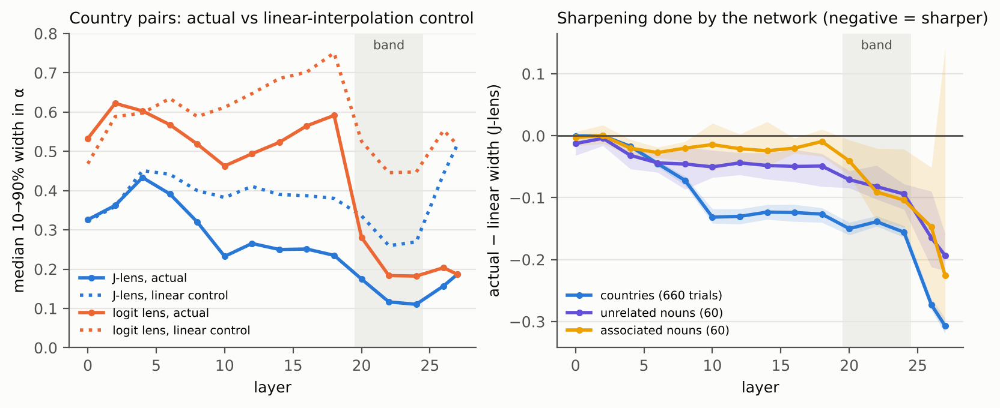

<!-- Draft fragment; merged into paper.md. Source: results/ignition_main*.json/.npy, results/ignition_main_stats.json (scripts/ignition_stats.py). -->

### 5.5 Ignition

**Protocol.** For a concept pair (A, B) in a carrier sentence, the slot token's input embedding is
replaced by α·e_A + (1 − α)·e_B for 21 values of α in [0, 1]. At the slot position and every second
layer we read A's reciprocal-rank share s = (1/r_A) / (1/r_A + 1/r_B). We measure the 10%→90%
transition width in α of the monotone-smoothed curve; a narrower width is a more abrupt switch. We
run three sets of pairs:

- 66 country pairs in 10 carriers (660 trials);
- 12 associated noun pairs, e.g. bread/butter (60 trials);
- 12 unrelated noun pairs, e.g. bread/chips (60 trials).

**The control.** A narrow width alone does not show that the network sharpens anything: the
reciprocal-rank share is itself non-linear in the logits. Our original reference line (0.8 for a
linear mix) was therefore not a valid baseline. The control runs only α = 0 and α = 1, interpolates
the two residuals in a straight line at each layer, and reads them with the same lens. It keeps the
readout's non-linearity and none of the network's.

- The actual run and the control agree at the endpoints (mean absolute share difference 0.0004).
- *Network sharpening* = actual width − control width, per trial.
- Intervals are cluster bootstraps over concept pairs.

**Table 4.** Median transition width for country pairs, and network sharpening (actual − control,
median of per-trial differences, 95% interval clustered by pair) for the J-lens.

| Layer | 0 | 8 | 12 | 16 | 20 | 22 | 24 | 27 |
|---|---|---|---|---|---|---|---|---|
| J-lens, actual | 0.33 | 0.32 | 0.27 | 0.25 | 0.17 | 0.12 | 0.11 | 0.19 |
| J-lens, linear control | 0.32 | 0.40 | 0.41 | 0.39 | 0.34 | 0.26 | 0.27 | 0.52 |
| logit lens, actual | 0.53 | 0.52 | 0.49 | 0.56 | 0.28 | 0.18 | 0.18 | 0.19 |
| logit lens, linear control | 0.47 | 0.59 | 0.65 | 0.70 | 0.53 | 0.45 | 0.45 | 0.52 |
| sharpening, countries | −0.00 | −0.07 [−0.08, −0.07] | −0.13 [−0.14, −0.12] | −0.12 [−0.14, −0.11] | −0.15 [−0.16, −0.14] | −0.14 [−0.15, −0.13] | −0.16 [−0.16, −0.15] | −0.31 [−0.32, −0.29] |
| sharpening, unrelated nouns | −0.01 | −0.05 [−0.09, −0.02] | −0.04 [−0.06, −0.03] | −0.05 [−0.07, −0.02] | −0.07 [−0.08, −0.06] | −0.08 [−0.10, −0.05] | −0.09 [−0.12, −0.08] | −0.19 [−0.22, −0.16] |
| sharpening, associated nouns | −0.00 | −0.02 [−0.04, −0.01] | −0.02 [−0.04, +0.00] | −0.02 [−0.03, −0.00] | −0.04 [−0.06, −0.01] | −0.09 [−0.14, −0.02] | −0.10 [−0.15, −0.02] | −0.23 [−0.32, +0.14] |

**Figure 5.** Left: transition widths for country pairs, actual (solid) and under the
linear-interpolation control (dotted), for both lenses. Right: network sharpening (actual − control)
for the J-lens by pair type, with 95% intervals clustered by pair. The shaded region is the
workspace band.

**The network does sharpen the switch, most for countries.** From layer 8 onward the actual
transition between two countries is narrower than a straight-line mix of the endpoint residuals
predicts:

- by 0.07 at layer 8;
- by 0.12–0.16 through layers 12–24.

The effect depends on the concepts:

- unrelated nouns sharpen by only about 0.05;
- associated pairs such as bread/butter barely sharpen before layer 20 (about 0.02).

Associated concepts evidently co-activate rather than compete, while two countries compete for the
same slot.

**But the sharpening is not located in the workspace band, and not specific to the J-lens.**

- It grows steadily to the output, reaching 0.31 at the final layer, with no peak in layers 20–24.
- Read through the logit lens, the network sharpens the country switch as much or more (0.22–0.25 at
  layers 20–24).
- The J-lens's narrower widths in the first pass are mostly a property of the readout. Under the
  control, J-lens widths are already 0.19–0.31 below the logit lens's in layers 8–16.

**What this says about ignition.** The model turns a gradual input mix into an increasingly
categorical choice between competing concepts, which is the behaviour ignition describes. At 0.6B
this happens progressively through depth, in the residual stream itself, rather than as an abrupt
event confined to a J-space band.
