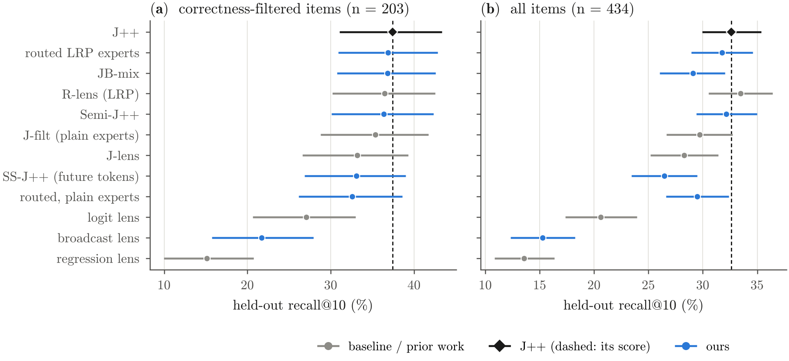

<!-- Draft fragment; merged into paper.md. Round 1: results/jpp_compare_main.json, results/jpp_compare_main_all.json (round-1 port of the weight search). Round 2 is in results_round2.md. -->

### 5.2 Head-to-head with J++ (round 1)

Table 2 gives held-out recall@10 under the J++ protocol: correctness-filtered items, 47 fitting
and 203 held-out items, best rank over seven layers, and Readout Filtering. For every lens the
fitting split selected the Readout-Filtered readout.

Figure 3 shows the same comparison graphically, with the all-items panel described at the end
of this section.

**Figure 3.** Round 1 held-out recall@10 with 95% item-bootstrap intervals, for
correctness-filtered items (left) and all items (right).

**Table 2.** Round 1, split seed 0. Held-out macro item recall@10 with 95% item-bootstrap CI.
The last column is the paired difference against J++ on the same items.

| Lens | labels? | fit split | held-out | Δ vs J++ [95% CI] |
|---|---|---|---|---|
| logit lens | no | 0.311 | 0.271 [0.206, 0.330] | −0.104 [−0.159, −0.048] |
| regression lens | no | 0.232 | 0.151 [0.100, 0.207] | −0.223 [−0.285, −0.167] |
| J-lens | no | 0.364 | 0.332 [0.266, 0.393] | −0.042 [−0.095, +0.012] |
| R-lens | no | 0.450 | 0.365 [0.302, 0.425] | −0.010 [−0.060, +0.042] |
| J-filt (plain experts + weights) | yes | 0.483 | 0.354 [0.288, 0.417] | −0.021 [−0.078, +0.036] |
| **J++** | yes | 0.500 | **0.374** [0.311, 0.434] | — |
| SS-J++ (ours, future tokens) | no | 0.385 | 0.331 [0.269, 0.390] | −0.043 [−0.080, +0.002] |
| Semi-J++ (ours) | yes | 0.483 | 0.364 [0.301, 0.423] | −0.011 [−0.029, +0.007] |
| Routed (plain, λ = 0.5) | no | 0.375 | 0.326 [0.262, 0.386] | −0.049 [−0.094, −0.013] |
| Routed-LRP (λ = 0.5)† | no | 0.450 | 0.369 [0.309, 0.428] | −0.005 [−0.057, +0.046] |
| Routed-LRP (adaptive, κ = 200) | no | 0.450 | 0.373 [0.312, 0.433] | −0.001 [−0.053, +0.050] |
| B-lens (ours) | no | 0.118 | 0.217 [0.157, 0.279] | −0.157 [−0.228, −0.085] |
| JB-mix (ours) | yes | 0.364 | 0.368 [0.307, 0.426] | −0.006 [−0.067, +0.058] |
| SS-JB-mix (ours) | no | 0.311 | 0.314 [0.248, 0.375] | −0.060 [−0.115, −0.005] |

† The variant the fitting split selected within the Routed-LRP family (λ = 0.5 and κ = 200 tie
on the fitting split; λ = 0.5 comes first).

**J++ is the strongest lens on this split, but by less than at scale.** J++ reaches 37.4% held-out recall@10,
against 33.2% for the J-lens. Ayonrinde & Lindsey report 35.7% → 55.2% on Qwen3.6-27B. Here the
gain is +4.2 points and its CI includes zero. Most of it comes from the LRP backward pass (J-lens
→ R-lens, +3.3 points). Jacobian filtering with learned weights adds +1.0 point (R-lens → J++).
The weights fit the 47 fitting items much better than they generalise: fitting-split recall is
0.500, against 0.374 held out. Over 25 fresh splits (§5.3–5.4), J++ leads the R-lens by 2.2 points,
so about a third of its gain comes from the learned weights.

**On this split, labels are not needed to match J++.** Routing each residual through its own
LRP expert, shrunk toward the pooled map, needs no labelled data. It matches J++ to within a
point (−0.005 for the variant the fitting split selected, −0.001 for count-adaptive shrinkage;
both CIs about ±0.05). Learning the expert weights from future tokens instead of labels (SS-J++)
recovers only the J-lens level (0.331). The semi-supervised variant is indistinguishable from J++
(−0.011 [−0.029, +0.007]). Over 25 fresh splits, though, the routed lens trails J++ by 1.6 points
(§5.4).

**The broadcast lens alone loses information but complements the J-lens.** Removing the
self-target terms cuts the lens's recall by a third (0.332 → 0.217). Removing the identity path evidently costs
more than the generic next-token predictions it suppresses. The B-lens does rank some
intermediates better than every other lens, for example "Earth" (rank 3, against 9–16) and the
language name "Dutch" (56, against 81–793). A labelled two-map mix of the J-lens and the B-lens (JB-mix) raises
held-out recall from 0.332 to 0.368, close to J++ with only two weights per layer instead of
eight. The fitting split does not show this gain (0.364 for both), so round 1 cannot tell
whether it is real. Over five fresh splits it mostly is not (§5.3).

**Where lenses differ.** Every lens scores 0 on association and poetry held-out items. All
differences come from 12 multihop, 12 multilingual and 77 typo items:

- J++ vs the J-lens: typo 0.857 vs 0.701, multilingual 0.431 vs 0.375, multihop the same
  (0.583).
- JB-mix is the only lens that recovers an extra multihop intermediate (0.667).

**All-items panel (secondary).** The correctness filter leaves only about a dozen held-out items
each on multihop and multilingual. We therefore repeated round 1 without it, on all 539 scored
items (105 fitting, 434 held-out, same split rule), as a pre-declared secondary analysis
(`results/jpp_compare_main_all.json`).

Every lens scores lower, since many items now involve answers the model gets wrong. The R-lens
is the best lens here, *above* J++:

| Lens | held-out recall@10 | Δ vs J++ [95% CI] |
|---|---|---|
| R-lens | 0.335 | +0.009 [−0.007, +0.026] |
| J++ | 0.326 | — |
| Semi-J++ | 0.322 | −0.005 [−0.015, +0.005] |
| Routed-LRP (κ = 200) | 0.318 | −0.009 [−0.025, +0.008] |
| JB-mix | 0.291 | −0.035 [−0.061, −0.010] |
| J-lens | 0.283 | −0.043 [−0.066, −0.021] |
| logit lens | 0.206 | −0.120 [−0.149, −0.090] |
| B-lens | 0.153 | −0.174 [−0.208, −0.139] |

Learning expert weights on the 105 fitting items does not beat the plain LRP map.

Like the rest of round 1, this panel used the earlier port of the weight search (§4).
