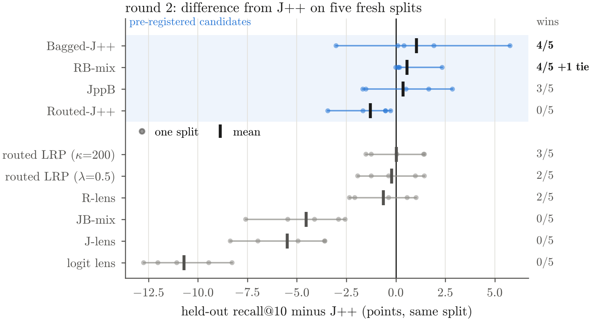

<!-- Draft fragment; merged into paper.md. Source: results/jpp_splits_round2.json, logs/round2.log. Protocol: paper/prereg_round2.md. -->

### 5.3 Round 2: pre-registered candidates on five fresh splits

Round 1 used one split, and its held-out items had already been looked at when we designed
improvements. Round 2 therefore tests four candidates fixed in advance (§3.6, `prereg_round2.md`):

- JppB;
- RB-mix;
- Routed-J++-a200;
- Bagged-J++.

The test uses five fresh stratified splits (seeds 1–5). On each split every label-dependent
weight is refitted on that split's 47 fitting items, and every lens is scored on its 203
held-out items. All weight searches use the faithful port of J++'s search (Amendment 1).

A candidate "beats J++" only if its mean paired difference over the five splits is positive *and*
it wins on at least four of them.

**Table 3.** Round 2. The first three numeric columns cover the confirmatory splits (seeds 1–5):

- mean held-out macro item recall@10;
- mean paired difference vs J++ on the same split, with the range over splits in brackets;
- number of splits on which the lens beats J++.

The last column is the faithful-port held-out score on the round-1 split (seed 0), which is
excluded from the confirmatory summary. Rows marked * are the pre-registered candidates.

| Lens | labels? | mean held-out | mean Δ vs J++ [range] | wins | seed 0 |
|---|---|---|---|---|---|
| logit lens | no | 0.285 | −0.107 [−0.127, −0.083] | 0/5 | 0.271 |
| J-lens | no | 0.338 | −0.055 [−0.084, −0.036] | 0/5 | 0.332 |
| R-lens | no | 0.386 | −0.006 [−0.023, +0.010] | 2/5 | 0.365 |
| B-lens | no | 0.210 | −0.183 [−0.204, −0.173] | 0/5 | 0.217 |
| Routed-LRP (λ = 0.5) | no | 0.390 | −0.002 [−0.019, +0.014] | 2/5 | 0.369 |
| Routed-LRP (adaptive, κ = 200) | no | 0.393 | +0.000 [−0.015, +0.014] | 3/5 | 0.373 |
| **J++** | yes | 0.392 | — | — | 0.367 |
| JB-mix | yes | 0.347 | −0.045 [−0.076, −0.026] | 0/5 | 0.362 |
| JppB* | yes | 0.396 | +0.004 [−0.017, +0.029] | 3/5 | 0.386 |
| Routed-J++-a200* | yes | 0.380 | −0.013 [−0.034, −0.003] | 0/5 | 0.348 |
| **RB-mix*** | yes | 0.398 | **+0.006** [+0.000, +0.023] | **4/5** (+1 tie) | 0.395 |
| **Bagged-J++*** | yes | **0.403** | **+0.010** [−0.030, +0.058] | **4/5** | 0.384 |

**Two candidates meet the criterion, by small margins.**

- **Bagged-J++** refits J++'s weights on eight stratified bootstrap resamples of the fitting
  items and averages them. It gains 1.0 point on average and wins on four of five splits.
- **RB-mix** fits two signed weights per layer over the unit-normalised R-lens and B-lens maps.
  It gains 0.6 points, wins on four splits, ties on the fifth, and is never behind J++.
- **JppB** (+0.4, 3/5) and **Routed-J++-a200** (−1.3, 0/5) do not meet the criterion.

By the rule we fixed in advance, Bagged-J++ and RB-mix beat J++ on this benchmark (Figure 4). Round 3
(§5.4) re-tested both on twenty more splits, and neither replicated.

**Figure 4.** Round 2: held-out recall@10 minus J++'s on the same split, for each of the five
confirmatory splits (dots), with the mean (bar). Split wins are on the right, in bold where the
pre-registered criterion is met. Shaded rows are the pre-registered candidates.

**The margins are small relative to the noise. We read them as "at least as good as J++", not
as a clear improvement.** Three facts argue for caution:

- **Per-split intervals.** RB-mix's paired 95% intervals include zero on every split.
  Bagged-J++'s exclude zero on two splits, but in opposite directions: +0.058 [+0.004, +0.124] on
  seed 4 and −0.030 [−0.069, −0.004] on seed 5.
- **Near-cancelling wins.** Three of RB-mix's four wins are below +0.002 in macro recall. Each is
  the net of gains and losses that nearly cancel. On seed 1, for example, RB-mix gains on
  multihop (+0.083) and typo (+0.039) but loses on multilingual (−0.104).
- **Overlapping splits.** Every split's held-out set is 80% of the same 250 items, so four wins
  out of five is weaker evidence than four independent replications.

**What bagging changes is J++'s overfitting.** J++'s per-layer search over eight signed weights,
with 47 fitting items, fits the fitting items well and generalises less well.

- Unfitted lenses score *lower* on the fitting items than on the held-out items: the R-lens gets
  0.340 against 0.386, so the fitting items happen to be about 4.6 points harder.
- Against that baseline, J++ is optimistic on its fitting items by about 14 points
  (0.484 against 0.392 held out).
- Bagged-J++ is optimistic by about 9 points (0.448 against 0.403).
- RB-mix, with two weights per layer, is optimistic by about 6 points (0.416 against 0.398).

The candidates that do well are those that give the 47 labelled items the least room to overfit.

**Where RB-mix gains.** RB-mix's advantage is concentrated in multihop:

- It improves on J++'s multihop recall on four of the five confirmatory splits (+0.04 to +0.17)
  and ties on the fifth.
- It scores below J++ on multilingual on three of them.

The fitted B-lens weight is positive at every layer from 11 onward on average:

| Layer | 11 | 14 | 18 | 21 | 24 |
|---|---|---|---|---|---|
| mean B-lens weight | 0.18 | 0.33 | 0.27 | 0.30 | 0.49 |

The R-lens weight is about 0.8–1.0, and both maps are unit-normalised. This matches round 1's
qualitative finding that the broadcast lens ranks some bridge entities that the other lenses
miss.

**What does not replicate.** Round 1's JB-mix gain over the J-lens (0.332 → 0.368 on seed 0) was
mostly a property of that split.

- Over seeds 1–5 JB-mix improves on the J-lens by only 0.010 on average (range −0.005 to +0.029),
  and trails J++ by 4.5 points.
- The B-lens adds to the R-lens (RB-mix) but barely to the J-lens.

**The faithful port and the round-1 split.** On seed 0 the faithful port gives J++ 0.367,
against 0.374 with the round-1 port. The difference is within noise, but it reorders the
round-1 comparison: the label-free routed LRP lens (0.373) is now 0.6 points *above* J++ on
that split. Over seeds 1–5 it ties J++ exactly on average (+0.000, 3/5 wins).

**How much do learned weights add at this scale?** Across these five splits J++ improves on the
J-lens by 5.5 points (range 3.6–8.4) but on the R-lens by only 0.6 (range −1.0 to +2.3). On these
splits alone, almost all of J++'s advantage seemed to come from the LRP backward pass. Round 3
(§5.4) revises this: over twenty more splits the expert weights add 2.6 points, about a third of
J++'s gain.
