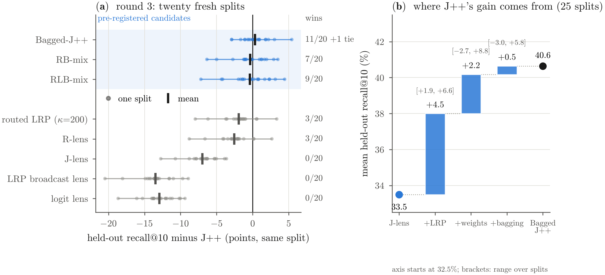

<!-- Draft fragment; merged into paper.md. Source: results/jpp_splits_round3.json, logs/round3.log. Protocol: paper/prereg_round3.md. -->

### 5.4 Round 3: the round-2 winners do not replicate

Round 2's two winners had margins smaller than a single split's paired interval, measured on five
splits that share most of their items. Round 3 re-tests them on twenty new splits (seeds 6–25),
under a pre-registration committed before any round-3 number existed (`prereg_round3.md`):

- Bagged-J++ and RB-mix, unchanged;
- one new candidate, RLB-mix: RB-mix with the broadcast lens computed through the LRP backward rules.

A candidate beats J++ only with a positive mean paired difference *and* at least 16 wins in 20.

**Table 5.** Round 3: twenty splits, each with 47 fitting and 203 held-out items. Out-of-pool
columns score the same fitted lenses on the 289 items that fail the correctness filter, which round 2
never scored. Rows marked * are the pre-registered candidates.

| Lens | labels? | mean held-out | mean Δ vs J++ [range] | wins/ties/losses | out-of-pool | Δ out-of-pool |
|---|---|---|---|---|---|---|
| Bagged-J++* | yes | **0.407** | +0.003 [−0.029, +0.054] | 11/1/8 | 0.223 | −0.005 |
| RB-mix* | yes | 0.401 | −0.004 [−0.063, +0.035] | 7/0/13 | 0.223 | −0.006 |
| RLB-mix* | yes | 0.400 | −0.004 [−0.072, +0.044] | 9/0/11 | 0.219 | −0.009 |
| **J++** | yes | 0.404 | — | — | 0.228 | — |
| routed LRP (κ = 200) | no | 0.385 | −0.019 [−0.080, +0.033] | 3/0/17 | 0.201 | −0.028 |
| R-lens | no | 0.378 | −0.026 [−0.088, +0.027] | 3/0/17 | **0.238** | +0.009 |
| J-lens | no | 0.334 | −0.070 [−0.127, −0.036] | 0/0/20 | 0.202 | −0.026 |
| logit lens | no | 0.275 | −0.129 [−0.187, −0.094] | 0/0/20 | 0.153 | −0.076 |
| LRP broadcast lens | no | 0.269 | −0.135 [−0.205, −0.089] | 0/0/20 | 0.117 | −0.111 |
| broadcast lens | no | 0.207 | −0.197 [−0.260, −0.154] | 0/0/20 | 0.060 | −0.168 |

**Figure 5.**

- (a) Round 3: each lens's held-out recall@10 minus J++'s on each of twenty splits (dots), with the
  mean (bar) and split wins.
- (b) Where J++'s gain over the J-lens comes from, as means over all 25 splits of rounds 2 and 3:
  - the LRP backward pass (J-lens → R-lens);
  - learned expert weights (R-lens → J++);
  - bagging (J++ → Bagged-J++).

  Brackets give each step's range over splits.

**No candidate beats J++.**

- Bagged-J++ is ahead by 0.3 points on average and wins 11 of 20 splits.
- RB-mix and RLB-mix trail by 0.4 points and win 7 and 9.
- None comes near the 16 wins required.
- The per-split intervals exclude zero for Bagged-J++ on 3 splits, and against RB-mix on 3.

Round 2's small wins were within noise. On this benchmark at 0.6B, nothing we tried beats J++ under
its own protocol.

**Bagging curbs overfitting without improving held-out recall.** J++ scores 9.8 points higher on
its fitting items than held out, against 4.0 for Bagged-J++ and RB-mix and about 1 for unfitted
lenses. The weights are less overfitted but generalise no better.

**Learned weights add more than round 2 suggested.** Over these twenty splits J++ beats the R-lens
by 2.6 points, on 17 of 20 splits (range −2.7 to +8.8). Pooled over all 25 splits of rounds 2 and 3
(Figure 5b), J++'s 6.7-point gain over the J-lens splits into:

- 4.5 points from the LRP backward pass;
- 2.2 points from the expert weights.

The LRP backward pass is therefore about two-thirds of J++'s gain, not nearly all of it as round 2's
five splits suggested.

**The label-free routed lens trails J++.** It tied J++ in round 2, but here it trails by 1.9 points,
with J++ ahead on 17 of 20 splits. Over all 25 splits it trails by 1.6 points and wins 6. Without
labels, a routed LRP lens gets within two points of J++, not to parity.

**LRP helps the broadcast lens too, but not in a mix.**

- The LRP rules raise the broadcast lens from 20.7% to 26.9%, on all 20 splits. That gain
  (+6.2 points) is a little larger than LRP's gain for the J-lens (+4.4).
- Mixed with the R-lens, the LRP broadcast lens does no better than the plain one: RLB-mix and
  RB-mix both trail J++ by 0.4.

**Out of pool, the plain R-lens is best.** On the 289 items the model answers wrongly, the R-lens
beats J++ by 0.9 points on 15 of 20 splits, and every candidate trails J++ slightly. This matches
the round-1 all-items panel (§5.2). Where the model has not computed the answer, weights tuned on
correctly answered items do not help.
