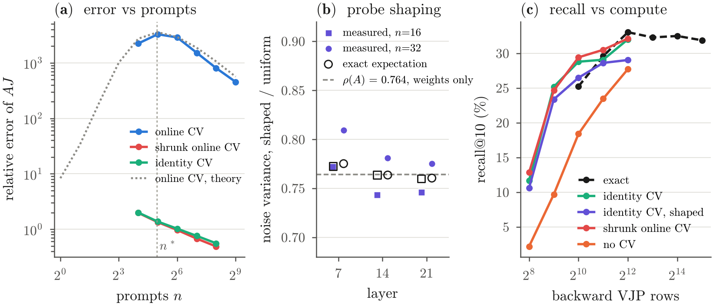

<!-- Draft fragment; merged into paper.md. Results: results/curves.json, results/sketch_theory.json, results/rho.json. -->

### 5.7 Sketch estimators

All sketches use K = 16 probes per prompt (d/K = 64) and the same records and probe draws (seed 1).
Errors are the relative error of the J-space dictionary A J at layers 7, 14 and 21 against an
independent reference, the exact lens on records 16–31. That reference is itself noisy, which
adds a floor shared by every estimator. Recall@10 is on correctness-filtered items.

**The planned estimator diverged.** The online control variate (§3.4) was our planned sketch, and
it is unusable (Table 6, Figure 7a). Its dictionary error reached 2,600–3,700 times the lens's own
norm at 32 prompts, and was still 355–518 at 512 prompts. Recall@10 was 0 at every budget up to
8,192 rows. Probe shaping did not rescue it (peak 2,100–2,900). Proposition 3 explains the failure:
each sketched prompt re-amplifies the running mean's error by d/K − 1 = 63, so the error grows
until n ≈ 31 and only then decays. The measured peak is at the predicted place. Three checks rule
out an implementation bug.

- *Replay.* Every sketch estimate is linear in the per-prompt Jacobian J_n. From the stored exact
  J_n of records 0–31 and the same probe draws, we rebuild the saved snapshots at 16 and 32 prompts
  of all six sketch runs. The rebuilt snapshots agree to within 3% (the J_n are stored in half
  precision). The divergence is the estimator's, not the VJP code's.
- *Monte Carlo.* With prompts resampled from the 32 (8 seeds, 512 prompts), the recursion of
  Proposition 3 predicts the online control variate's mean squared error to within 15% at every n
  from 1 to 512, across five orders of magnitude, and the identity control variate's to within 3%.
- *Exact expectation.* For a fixed control variate and the actual prompts, the expected sketch noise
  has a closed form (Haar moments; `scripts/sketch_theory.py`). It matches the measured noise of the
  real-model runs to within 1.2% at 16 prompts and 3% at 32 (Table 7).

**Table 6.** Sketch estimators at a matched budget of 4,096 VJP rows (4 exact prompts or 256
sketched ones). Error is the relative error of A J (lower is better); recall@10 with 95% bootstrap
CI.

| Estimator | Prompts | Error L7 | Error L14 | Error L21 | Recall@10 (%) | All items (%) |
|---|---|---|---|---|---|---|
| exact | 4 | 0.742 | 0.550 | **0.287** | **33.0** [27.5, 38.2] | **27.3** |
| sketch, no control variate | 256 | 0.702 | 0.615 | 0.558 | 27.7 [21.9, 33.1] | 20.1 |
| sketch, identity control variate | 256 | 0.698 | 0.589 | 0.385 | 32.0 [27.5, 37.0] | 22.6 |
| identity control variate, shaped probes | 256 | **0.642** | 0.538 | 0.348 | 29.0 [23.5, 34.2] | 21.9 |
| shrunk online control variate (post hoc) | 256 | 0.658 | **0.512** | 0.300 | 32.1 [27.0, 36.9] | 25.1 |
| online control variate (planned) | 256 | 915 | 863 | 633 | 0.0 | 0.0 |

**Table 7.** Sketch noise ‖A(Ĵ − J̄_n)‖/‖A J̄_n‖ at n = 32 prompts, where J̄_n is the exact lens on
the same 32 prompts: exact expectation / measured.

| Estimator | Layer 7 | Layer 14 | Layer 21 |
|---|---|---|---|
| no control variate | 1.839 / 1.785 | 1.646 / 1.623 | 1.547 / 1.537 |
| identity control variate | 1.823 / 1.770 | 1.557 / 1.533 | 1.013 / 0.998 |
| identity, shaped probes | 1.605 / 1.592 | 1.360 / 1.354 | 0.884 / 0.879 |

**Figure 7.** (a) Dictionary error against prompts. The online control variate (blue) follows the
variance recursion of Proposition 3 (dotted), peaking near n* = 31. The identity and shrunk control
variates are stable. Errors are averaged over layers 7, 14 and 21. (b) Noise variance of shaped
probes relative to uniform ones: measured on the real-model runs (filled), its exact expectation for
the same prompts (open), and the weights-only prediction ρ(A) (dashed). (c) Recall@10 against
backward VJP rows. The online control variate scores 0 at every budget and is not shown.

**Shaping works as predicted, but does not improve recall.** Shaped probes cut the sketch-noise
variance by a factor of 0.74–0.81 across layers and budgets (Figure 7b). The exact expectation for
these prompts is 0.76–0.78. The weights-only predictor ρ(A) = 0.764, computed before any Jacobian,
falls in the same range. With the measured second moment of J_n − I in place of an isotropic prior,
the factor is 0.760–0.775, so isotropy is a good approximation for this model. At 256 prompts,
shaping lowers the dictionary error by 8–10% at every layer. Recall@10 does not improve (29.0%
against 32.0%; the CIs overlap). A candidate explanation, which we have not tested, is that the
readout normalises J h before W_U. Noise that W⁻¹ amplifies in directions A barely reads still
enters that norm.

**Sketches against the exact estimator.** The Corollary to Proposition 2 says that with independent
prompts no sketch can beat the exact estimator at equal cost. For J₀ = I it predicts variance ratios
of 2.1, 3.3 and 5.7 at layers 7, 14 and 21. The Monte Carlo, which resamples prompts independently,
agrees: at 4,096 rows the identity control variate's squared error is 2.1, 3.5 and 6.7 times the
exact estimator's. On the real corpus the gap nearly vanishes (Table 6). At equal rows, both the identity and shrunk
sketches beat the exact estimator at layer 7, and the shrunk sketch also beats it at layer 14. At
layer 21 the exact estimator stays ahead (0.287 against 0.300 and 0.385). Correlated records explain
the difference.
- Consecutive WikiText records are correlated. Jacobians of adjacent records are 25–38% closer, in
  squared distance, than those of records at least 8 apart.
- The difference between the exact lenses from records 0–15 and 16–31 is 2.0–2.5 times its
  prediction under independence.
- The exact estimator's four prompts are four consecutive records. The sketch spreads the same
  budget over 256 records, which buys distinct contexts, as §3.4 anticipated.

Recall@10 saturates early in any case. The exact estimator reaches 32–33% at 4 prompts and stays
there through 32 prompts. The identity and shrunk sketches reach the same level (32.0% and 32.1%)
at the same 4,096 rows.

**The shrunk control variate (exploratory).** We derived the shrunk online control variate (§3.4)
after the online one diverged, and ran it once on the real model. It is stable. At 256 prompts its
dictionary error is 6–22% below the identity control variate's (Table 6), and its all-items recall
is 25.1% against 22.6%. In the Monte Carlo it is never more than 1% worse than the identity control variate, at any n. At
512 prompts it reaches 0.64, 0.50 and 0.36 of the identity variate's variance, as the recursion
predicts (0.66, 0.49, 0.36).

**Practical upshot.** To fit a J-lens, use the exact estimator on prompts drawn from many documents.
A sketch helps when the budget is below one exact prompt, or when only correlated prompts are
cheap. In that case use the identity or the shrunk control variate, never the plain running mean.
Probe shaping lowers the readout-weighted error by the predicted ρ(A), but it did not improve recall
here.
