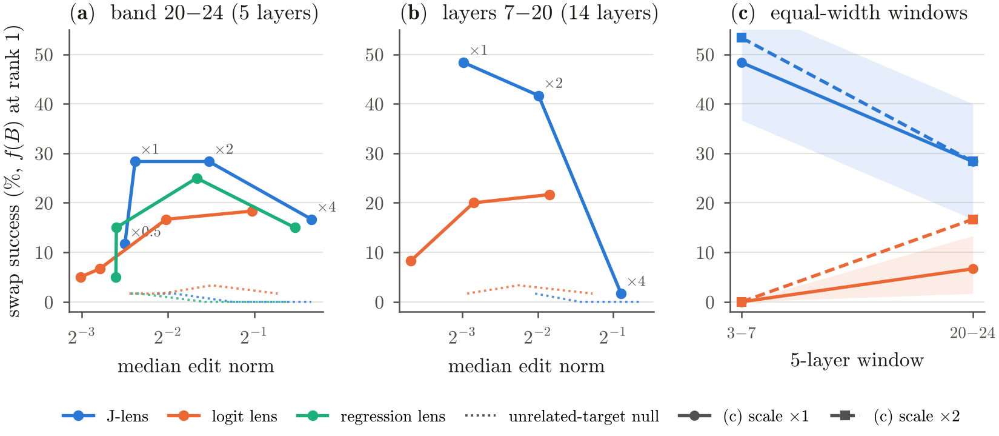

<!-- Draft fragment; merged into paper.md. Source: results/swaps_main*.json, results/swaps_midband*.json, results/swap_stats.json (scripts/swap_stats.py). -->

### 5.5 Causal swaps

**Protocol.** We follow the reference clamp swap. At every layer of a band, and at every position
after the first, we take the unit lens directions u_s and u_t of a source and a target token. We
re-express the residual in the plane they span and exchange the two coefficients, multiplied by a
scale factor. We report the scale and the resulting relative change of the final-position
residual (the edit norm).

Each trial uses directions from three lenses:

- the J-lens;
- the logit lens;
- the ridge regression lens.

A random-target null replaces the target with an unrelated noun. Only trials whose unedited
answer is correct are scored. A trial succeeds when the swapped answer becomes the model's top
word. Two experiments use the released prompts:

- **Flexible generalisation.** Templates "f(A)" (for example "The capital of A is the city of")
  over four categories with four functions each; A is swapped for another argument B, and
  success means f(B).
- **Probe-swap.** Two-hop prompts; the latent intermediate is swapped.

**Workspace band (layers 20–24).** The model answers 60 of the 170 flexible-generalisation
prompts correctly; these 60 are scored. Paired differences are on the same trials, with
discordant counts in brackets (J-lens only / other lens only):

| scale | J-lens | logit lens | regression lens | J − logit [95% CI] | J − regression [95% CI] |
|---|---|---|---|---|---|
| 0.5 | 0.117 (edit 0.18) | 0.050 (0.12) | 0.050 (0.16) | +0.067 [+0.017, +0.133] (4/0) | +0.067 [+0.017, +0.133] (4/0) |
| 1 | **0.283** (0.19) | 0.067 (0.14) | 0.150 (0.17) | **+0.217** [+0.117, +0.317] (13/0) | +0.133 [+0.050, +0.217] (8/0) |
| 2 | 0.283 (0.35) | 0.167 (0.25) | 0.250 (0.31) | +0.117 [+0.017, +0.217] (9/2) | +0.033 [−0.050, +0.133] (5/3) |
| 4 | 0.167 (0.79) | 0.183 (0.49) | 0.150 (0.69) | −0.017 [−0.067, +0.033] (1/2) | +0.017 [−0.050, +0.100] (3/2) |

The random-target null succeeds on at most 1 of 56 trials at any scale and for any lens.

**Figure 5.**

- (a, b) Flexible-generalisation swap success against the median edit norm (relative change of the
  final-position residual), for each lens and scale (labels), in the two pre-planned bands.
- (c) Swap success in equal-width 5-layer windows (exploratory). The shaded areas are 95%
  intervals at scale 1.

Dotted lines are the unrelated-target nulls.

**J-lens directions are the most efficient handle on the swapped argument.** At scale 1, a swap
along J-lens directions installs f(B) on 28% of trials. Logit-lens directions do so on 7% and
regression-lens directions on 15%. Every discordant trial favours the J-lens (13/0 and 8/0).

The J-lens edit is slightly larger at the same scale (0.19 against 0.14). The advantage survives
matching edit norms: the logit lens at scale 2 (edit 0.25) still reaches only 17%.

As the scale grows, every lens's success falls back to 15–18%. The edit then destroys the
original answer on 97–100% of trials without reliably installing the new one.

**The effect is carried by one category.** By category at scale 1:

| Category | J-lens | logit lens | regression lens |
|---|---|---|---|
| countries | 16/36 | 4/36 | 9/36 |
| months | 1/3 | 0/3 | 0/3 |
| animals | 0/6 | 0/6 | 0/6 |
| numbers | 0/15 | 0/15 | 0/15 |

Arithmetic-like functions of number words, and animal attributes, are not moved by any lens's
directions in this band.

**Probe-swap is uninformative at this scale.** The model answers only 8 of the 83 usable
two-hop prompts correctly. On those 8:

- swapping the intermediate succeeds on at most 2 for any lens and scale;
- the answer-swap ceiling (swapping the answer token itself) succeeds on 6 of 8 for the J-lens
  at scale 1.

We draw no conclusion from 8 trials.

**Mid-depth band (layers 7–20).** Both swap runs were queued before either produced a result.
The second band covers the mid-depth layers where the J-lens's readout advantage over the logit
lens lies (§5.1). It edits 14 layers rather than 5, so the two bands are not matched in the
number of edited layers. On the same 60 flexible-generalisation trials:

| scale | J-lens | logit lens | J − logit [95% CI] (discordant) |
|---|---|---|---|
| 1 | **0.483** (edit 0.13) | 0.083 (0.08) | **+0.400** [+0.267, +0.533] (25/1) |
| 2 | 0.417 (0.25) | 0.200 (0.14) | +0.217 [+0.083, +0.350] (17/4) |
| 4 | 0.017 (0.54) | 0.217 (0.28) | −0.200 [−0.317, −0.100] (1/13) |

The random-target null succeeds on at most 1 of 57 trials.

At scale 1, J-lens swaps across the mid-depth band install the new argument's answer on 48% of
trials, against 8% for logit-lens directions. On countries the rate is 27 of 36, against 5 of 36.
Two of six animal trials also succeed, which no lens achieves in the workspace band.

At scale 4 the J-lens edit, summed over 14 layers, breaks the computation. Success collapses to
1 of 60 while the logit lens holds at 22%.

**What this says about the workspace band.** Causal leverage through J-lens directions is
real, specific (the null almost never succeeds) and far above the logit-lens control. But at
this scale it is not confined to the band our pre-declared readout rule selected:

- An edit of smaller norm spread over layers 7–20 moves the answer more often than an edit of
  the late band 20–24.
- In those layers the logit lens reads out almost nothing (§5.1), yet J-lens directions there
  are the most effective handles we found.

**Depth, not the number of edited layers (exploratory).** The two bands differ in width, so we
added four equal-width 5-layer windows after seeing them (`scripts/run_windows.sh`). Same 60
flexible-generalisation trials, scale 1:

| Window | J-lens | logit lens | J − logit [95% CI] (discordant) | unrelated-target null, J-lens | J-lens edit norm |
|---|---|---|---|---|---|
| layers 3–7 | **0.483** | 0.000 | +0.483 [+0.350, +0.600] (29/0) | 0.064 | 0.08 |
| layers 7–11 | 0.433 | 0.017 | +0.417 [+0.300, +0.533] (25/0) | 0.042 | 0.10 |
| layers 11–15 | 0.433 | 0.017 | +0.417 [+0.300, +0.533] (25/0) | 0.088 | 0.08 |
| layers 15–19 | 0.450 | 0.017 | +0.433 [+0.316, +0.550] (26/0) | 0.036 | 0.06 |
| layers 20–24 (readout band) | 0.283 | 0.067 | +0.217 [+0.117, +0.317] (13/0) | 0.018 | 0.19 |

- **Every 5-layer window from layer 3 to 19 does better than the readout band.** J-lens swaps
  succeed on 43–48% of trials in those windows, against 28% in layers 20–24, with edits half the
  size or less.
- **The drop is significant on paired trials.** Layers 15–19 beat layers 20–24 by +0.167
  [+0.050, +0.283] (12 trials only in the window, 2 only in the band).
- **The logit lens moves almost nothing before layer 20** (0–2%).
- **The control rises but stays small.** The unrelated-target null is higher in the early windows
  (4–9%), so the specific effect there is about 35–45 points.
- **Countries again carry the effect** (24–27 of 36 per window).

It is depth, then, not the number of edited layers. The J-lens direction of the argument is an
effective causal handle from layer 3 to layer 19. It becomes less effective exactly where readouts
peak and where the logit lens starts to read out the answer. That fits the function having
largely been applied by layers 20–24, so that swapping its argument there comes too late.

**What this says about the workspace band.** At 0.6B, the layers where the J-lens reads out most
are not the layers where its directions matter most causally. J-lens directions behave like the
model's working representation of the argument through early and mid depth. This is evidence
against a narrow late workspace in a 0.6B model; these windows were added after seeing the
pre-planned bands, so the result is exploratory.
